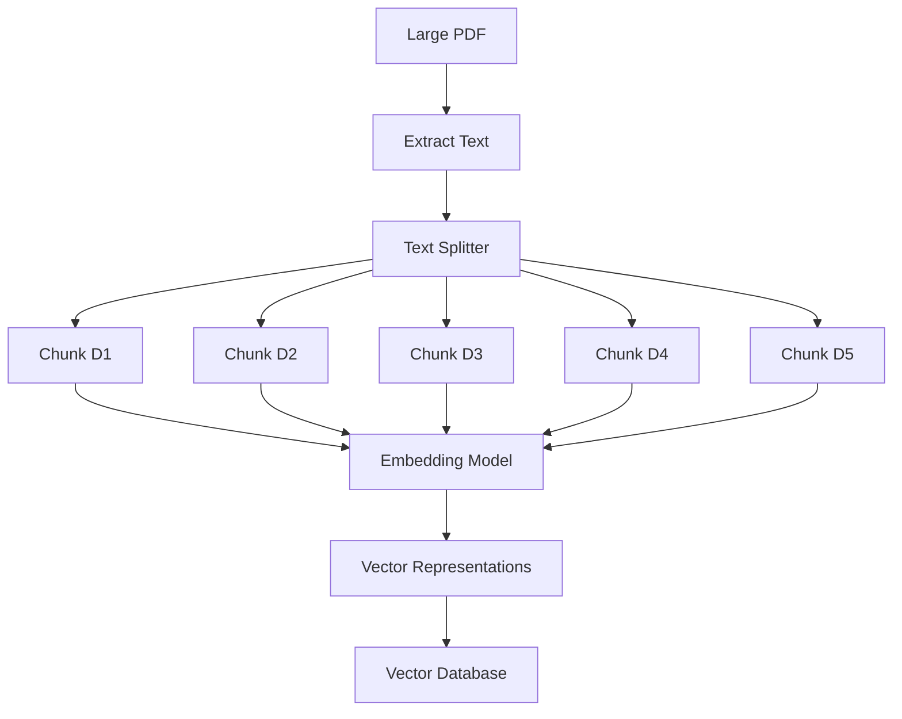

Great question. In a RAG application, $D_1,D_2,D_3,D_4,D_5$ can represent five smaller chunks created from a large PDF document. They are not necessarily five separate PDF files.

Let's understand how this works with an example.

## 1. Start with a large PDF

Suppose you have a 50-page PDF called `machine_learning.pdf`.

machine\_learning.pdf

50 pages · One source document

The PDF contains sections about:

- Introduction to machine learning
- Supervised learning
- Unsupervised learning
- Neural networks
- Model evaluation

You generally don't want to send the entire PDF to the LLM for every question. Instead, you split the PDF text into smaller pieces called chunks.

## 2. Extract the text and split it into chunks

The first step is to extract text from the PDF using a PDF loader. Next, a text splitter divides the extracted text into manageable sections.

For example, suppose we use a chunk size of 500 characters and an overlap of 50 characters.

Original PDF text

50 pages of extracted text

Text splitter

D₁

Chunk 1

Characters 0–499

D₂

Chunk 2

Characters 450–949

D₃

Chunk 3

Characters 900–1399

D₄

Chunk 4

Characters 1350–1849

D₅

Chunk 5

Characters 1800–2299

Illustrative example: chunks overlap by 50 characters to preserve context between adjacent sections.

The chunks are called $D_1,D_2,\ldots,D_n$, where $n$ is the total number of chunks generated from the PDF.

Important: The actual number of chunks depends on the PDF's text length, chunk size, overlap, and splitting strategy. A 50-page PDF might produce hundreds of chunks, not just five.

## 3. What does each chunk contain?

Imagine the PDF contains the following text:

Original text:

> Machine learning is a branch of artificial intelligence. It enables computers to learn patterns from data. Supervised learning uses labeled training data to predict outcomes. Unsupervised learning identifies patterns in unlabeled data.

A text splitter might divide it into chunks like these:

| Chunk | Example content |
| --- | --- |
| $D_1$ | Machine learning is a branch of artificial intelligence. |
| $D_2$ | It enables computers to learn patterns from data. |
| $D_3$ | Supervised learning uses labeled training data to predict outcomes. |
| $D_4$ | Unsupervised learning identifies patterns in unlabeled data. |
| $D_5$ | Additional text from the following section of the PDF. |

These are illustrative chunks. Real splitters generally divide text according to character counts, token counts, separators, or document structure rather than necessarily splitting at exactly these sentence boundaries.

## 4. How do these chunks enter the RAG pipeline?

Once the chunks are created, each chunk is processed separately.

For example:

$$
D_1 \rightarrow \mathbf{v}_1
$$

$$
D_2 \rightarrow \mathbf{v}_2
$$

$$
D_3 \rightarrow \mathbf{v}_3
$$

And so on.

Each chunk is converted into a numerical embedding, and its vector is stored in the vector database along with the chunk's text and potentially useful metadata.

The metadata could include:

- Source PDF filename
- Page number
- Chunk ID
- Section title

This metadata helps the application identify where retrieved information came from.

## 5. How does hybrid search use these chunks?

Suppose a user asks:

"What is supervised learning?"

The query is processed by both retrieval methods:

- Semantic search: Finds chunks that discuss supervised learning, even if the wording differs from the query.
- Keyword search: Finds chunks containing terms such as "supervised learning" and "labeled training data."

The two methods might return the following rankings:

| Rank | Semantic search | Keyword search |
| --- | --- | --- |
| 1 | $D_3$ | $D_3$ |
| 2 | $D_1$ | $D_4$ |
| 3 | $D_4$ | $D_2$ |

The system then combines the rankings using a method such as Reciprocal Rank Fusion (RRF).

Because $D_3$ ranks first in both lists, it receives strong combined support and is likely to appear near the top of the final results.

The retrieved chunk is then passed to the LLM as context so that it can answer the user's question.

## 6. The most important distinction

- PDF: The original source document.
- Chunk ($D_i$): A smaller piece of text extracted from that PDF.
- Embedding ($\mathbf{v}_i$): The numerical representation of a chunk.
- Vector database: Stores or indexes the representations and associated information.
- Retrieval result: A chunk selected as relevant to a user's query.

In short:

$$
\boxed{
\text{One PDF}
\rightarrow
\text{Many chunks }(D_1,\ldots,D_n)
\rightarrow
\text{Embeddings}
\rightarrow
\text{Vector Database}
}
$$

So, when we use $D_1,D_2,\ldots,D_5$ in the hybrid-search example, we're simply using five illustrative document chunks to make the ranking calculations easier to understand. In a real application, those chunks could come from one PDF or from thousands of different documents.