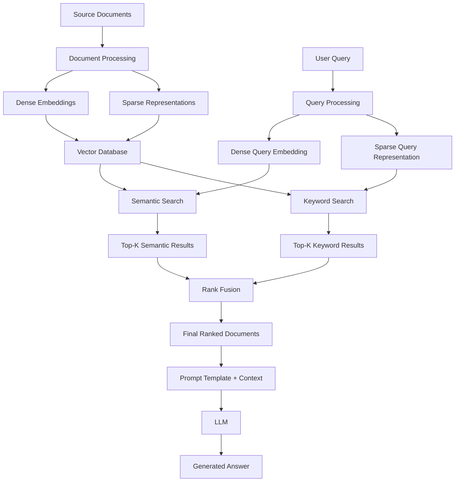

This article explains the mathematical foundations of hybrid search in Retrieval-Augmented Generation (RAG) applications. It covers semantic search, lexical search, dense and sparse vector representations, similarity metrics, Reciprocal Rank Fusion, graph-based retrieval, and an end-to-end implementation workflow using LangChain and Pinecone.

The goal is to understand not only how hybrid search works, but also the mathematical concepts behind it and why combining different retrieval methods can improve the quality of a RAG application.

## 1. What is RAG?

**RAG (Retrieval-Augmented Generation)** is a technique that retrieves relevant information from a knowledge source and supplies it to a Large Language Model (LLM) to generate a response.

Instead of relying exclusively on the information learned during training, an LLM can use relevant external documents retrieved at query time.

### The RAG pipeline
The typical RAG pipeline consists of the following stages:

mermaid
```

flowchart TD
    A["Source Documents<br/>PDFs, text files, web pages"] --> B["Document Chunking"]
    B --> C["Embedding Generation"]
    C --> D["Vector Database"]
    E["User Query"] --> F["Query Embedding"]
    F --> G["Similarity Search"]
    D --> G
    G --> H["Retrieve Relevant Documents"]
    H --> I["Prompt Template + Context"]
    I --> J["Large Language Model"]
    J --> K["Generated Answer"]

```
### Step 1: Source documents

The process begins with documents containing information that the application needs to retrieve.

These documents might include:

- PDF files
- Text files
- Web pages
- Technical documentation
- Company knowledge bases
- Research papers

### Step 2: Document chunking

Large documents are divided into smaller sections called chunks.

For example, a document collection can be represented as:

$$
D=\{D_1,D_2,D_3,\ldots,D_n\}
$$

Where each $D_i$ represents an individual document chunk.

Chunking helps the retrieval system identify specific sections of a document instead of retrieving an entire document every time.

### Step 3: Embedding generation

Each text chunk is converted into a numerical representation called an embedding.

For example:

$$
D_1 \rightarrow \mathbf{v}_1
$$

$$
D_2 \rightarrow \mathbf{v}_2
$$

$$
D_3 \rightarrow \mathbf{v}_3
$$

Here, $\mathbf{v}_1,\mathbf{v}_2,\mathbf{v}_3$ are vector representations of the document chunks.

### Step 4: Store embeddings in a vector database

The embeddings are stored in a vector database, such as Pinecone.

A vector database stores vector representations alongside associated text or metadata and provides mechanisms for retrieving relevant vectors.

### Step 5: Query processing and retrieval

When a user submits a query, the query is converted into a vector using the embedding model.

The system compares the query vector with document vectors and retrieves the most relevant chunks.

### Step 6: Response generation

The retrieved documents are combined with a prompt template and supplied to the LLM.

The LLM uses the retrieved context to generate the final response.

The overall process can be summarized as:

$$
\boxed{
\text{Documents}
\rightarrow
\text{Embeddings}
\rightarrow
\text{Retrieval}
\rightarrow
\text{Context}
\rightarrow
\text{LLM Answer}
}
$$

---

# 2\. Mathematical and Technical Terminology

Before understanding hybrid search, it is useful to become familiar with the important mathematical and technical terms.

| Term | Meaning |
| --- | --- |
| Vector | An ordered list of numerical values representing data. |
| Embedding | A numerical representation of text generated by an embedding model. |
| Dense vector | A vector in which most values are nonzero. |
| Sparse vector | A vector in which most values are zero. |
| Vector dimension | The number of numerical components in a vector. |
| Similarity score | A numerical measure of how similar two vectors are. |
| Cosine similarity | A measure of similarity based on the angle between two vectors. |
| TF-IDF | Term Frequency–Inverse Document Frequency, a method for weighting text terms. |
| Bag of Words (BoW) | A representation based on word occurrence or frequency, typically disregarding word order. |
| One-hot encoding | A representation in which one category is marked with 1 and the others with 0. |
| Top-$K$ results | The $K$ highest-ranked search results. |
| Rank | The position of a document in a search result list. |
| Weight | A numerical factor controlling the contribution of a search method. |
| Reciprocal Rank Fusion (RRF) | A method that combines rankings from multiple retrieval systems. |
| Dot product | The sum of the products of corresponding vector components. |
| Metric | A mathematical measure used to compare vectors or other objects. |

These concepts form the foundation for understanding how semantic search, keyword search, and hybrid search operate.

---

# 3\. Semantic Search and Cosine Similarity

Semantic search attempts to find documents with meanings similar to a user's query, even when the exact words are different.

For example:

- **Query:** "How do I purchase a vehicle?"
- **Document:** "Steps for buying a car."

The wording differs, but the underlying meaning is similar.

A semantic search system uses embeddings to represent the meaning of text numerically. It then compares the query embedding with document embeddings to identify relevant results.

## 3.1 Cosine similarity formula

Cosine similarity is one of the most widely used measures for comparing embedding vectors.

The formula is:

$$
\boxed{
\operatorname{cosine}(A,B)
=
\frac{A\cdot B}{\|A\|\|B\|}
}
$$

Where:

- $A$ and $B$ are two vectors.
- $A\cdot B$ is their dot product.
- $\|A\|$ and $\|B\|$ are their magnitudes, also called Euclidean norms.

The dot product is calculated as:

$$
A\cdot B=\sum_{i=1}^{n}A_iB_i
$$

The magnitude of a vector is:

$$
\|A\|=\sqrt{\sum_{i=1}^{n}A_i^2}
$$

### Example

Suppose we have two vectors:

$$
A=(1,0)
$$

$$
B=(0.8,0.6)
$$

First, calculate their dot product:

$$
A\cdot B=(1)(0.8)+(0)(0.6)=0.8
$$

Next, calculate their magnitudes:

$$
\|A\|=\sqrt{1^2+0^2}=1
$$

$$
\|B\|=\sqrt{0.8^2+0.6^2}
$$

$$
\|B\|=\sqrt{0.64+0.36}=1
$$

Now substitute these values into the cosine similarity formula:

$$
\operatorname{cosine}(A,B)
=
\frac{0.8}{1\times1}
$$

Therefore:

$$
\boxed{\operatorname{cosine}(A,B)=0.8}
$$

The cosine similarity is $0.8$, indicating a fairly high directional similarity.

For nonzero vectors, cosine similarity ranges from $-1$ to $1$, although many embedding models produce nonnegative similarities in common applications.

### Why cosine similarity matters in RAG

When a user submits a query, the system generates a query embedding and compares it with stored document embeddings.

Documents with higher similarity scores can be ranked as more relevant to the query.

This process is commonly called **vector search** or **semantic search**.

---


# 4\. Dense Vectors vs. Sparse Vectors

Hybrid search combines two complementary ways of representing and retrieving text.

These representations are called dense vectors and sparse vectors.

## 4.1 Dense vectors

Dense vectors are numerical representations in which most components are nonzero.

For example:

$$
\mathbf{v}=
[0.21,\ 0.74,\ -0.13,\ 0.58]
$$

Dense vectors are generally generated using embedding models.

Examples include:

- OpenAI embedding models
- Hugging Face embedding models
- Sentence Transformers
- Other transformer-based embedding models

Dense embeddings attempt to capture semantic information about text.

For example, a semantic search system may understand that the following expressions are related:

- Automobile
- Car
- Vehicle
- Motor vehicle

Even if the exact words differ, their meanings are similar.

Dense vectors are particularly useful for:

- Semantic search
- Finding paraphrases
- Discovering conceptually related content
- Retrieving documents based on meaning rather than exact wording

## 4.2 Sparse vectors

Sparse vectors contain mostly zero values, with only a small number of nonzero components.

For example:

$$
\mathbf{s}=
[0,\ 0,\ 3.2,\ 0,\ 1.5,\ 0]
$$

In this representation, only selected components have nonzero values.

These values may represent the presence of terms, term frequencies, or term weights.

Sparse representations are commonly associated with lexical retrieval methods.

They are useful for:

- Exact keywords
- Product identifiers
- Names
- Technical terminology
- Error codes
- Rare terms
- Queries in which exact wording matters

Sparse vectors are not necessarily limited to zeros and ones. One-hot encoding uses binary values, while TF-IDF and BM25-style representations can use weighted values.

## 4.3 Comparison between dense and sparse vectors

| Feature | Dense vectors | Sparse vectors |
| --- | --- | --- |
| Typical representation | Mostly nonzero values | Mostly zero values |
| Common retrieval approach | Semantic search | Lexical or keyword search |
| Main objective | Find similar meaning | Find matching terms |
| Paraphrase handling | Usually strong | May miss semantically related terms |
| Exact identifier matching | Can be less reliable | Often strong |
| Common techniques | Transformer embeddings | One-hot encoding, BoW, TF-IDF, BM25-related methods |
| Example | "Automobile" matches "car" | "INV-2026-105" matches the exact identifier |

Dense and sparse representations have different strengths.

This is the main reason hybrid search combines them rather than relying on only one approach.

---

# 5\. Methods Used to Create Sparse Representations

Several methods can represent text as sparse numerical features.

The video discusses one-hot encoding, Bag of Words, and TF-IDF.

## 5.1 One-hot encoding

One-hot encoding represents a category using a vector in which one position is set to 1 and the remaining positions are set to 0.

Suppose the vocabulary contains three words:

$$
V=\{\text{cat},\text{dog},\text{bird}\}
$$

Their representations can be:

$$
\text{cat}=[1,0,0]
$$

$$
\text{dog}=[0,1,0]
$$

$$
\text{bird}=[0,0,1]
$$

Each word has one active position.

One-hot encoding is useful for understanding sparse representations, although it does not capture semantic similarity between words.

For example, the vectors for "cat" and "dog" are different even though both represent animals.

## 5.2 Bag of Words (BoW)

Bag of Words represents text using word counts or occurrences.

It typically ignores the order of words in a sentence.

Suppose the vocabulary is:

$$
V=[\text{cat},\text{dog},\text{bird}]
$$

Consider the sentence:

"cat cat dog"

The word counts are:

- Cat: 2
- Dog: 1
- Bird: 0

The Bag of Words representation becomes:

$$
\boxed{[2,1,0]}
$$

The representation is sparse because the word "bird" does not occur in the sentence.

Unlike one-hot encoding, Bag of Words can represent the frequency of multiple terms in a document.

## 5.3 TF-IDF

TF-IDF stands for **Term Frequency–Inverse Document Frequency**.

It is a statistical weighting method used in information retrieval and text analysis.

TF-IDF gives importance to terms based on two factors:

1. How frequently a term appears in a particular document.
2. How uncommon that term is across the document collection.

A common formula is:

$$
\boxed{
\operatorname{TFIDF}(t,d)
=
\operatorname{TF}(t,d)
\times
\operatorname{IDF}(t)
}
$$

Where:

- $t$ represents a term.
- $d$ represents a document.
- $\operatorname{TF}(t,d)$ represents the term frequency.
- $\operatorname{IDF}(t)$ represents the inverse document frequency.

One common inverse document frequency definition is:

$$
\boxed{
\operatorname{IDF}(t)=
\log\left(
\frac{N}{\operatorname{DF}(t)}
\right)
}
$$

Where:

- $N$ is the total number of documents.
- $\operatorname{DF}(t)$ is the number of documents containing the term.

### Understanding TF-IDF

Consider two terms:

- "the"
- "photosynthesis"

The word "the" may occur in almost every document. It does not usually distinguish one document from another.

The word "photosynthesis" may occur in only a small number of documents. It can therefore be more useful when identifying documents about plant biology.

TF-IDF attempts to assign greater importance to terms that are frequent within a particular document but uncommon across the collection.

Exact TF-IDF formulas vary by implementation, including smoothing, normalization, and term-frequency definitions.

### Important distinction: TF-IDF vs. BM25

BM25 is related to the TF-IDF family of methods, but it is not simply the same as TF-IDF.

BM25 is a lexical information-retrieval ranking method that considers factors such as term frequency, inverse document frequency, and document length.

The specific sparse encoder used in an implementation must be checked to determine whether it produces TF-IDF weights, BM25-style weights, or another representation.

---

# 6\. What Is Hybrid Search?

Hybrid search combines semantic retrieval and lexical retrieval instead of relying on only one search method.

The two primary components are:

1. Semantic search using dense vectors.
2. Keyword or lexical search using sparse representations or an inverted index.

The combination can improve retrieval coverage because the two approaches address different weaknesses.

## 6.1 Semantic search vs. keyword search

| Feature | Semantic search | Keyword search |
| --- | --- | --- |
| Representation | Dense vectors | Sparse vectors or an inverted index |
| Main goal | Find similar meaning | Find matching terms |
| Paraphrases | Usually strong | May miss them |
| Exact names and IDs | Can be less reliable | Often strong |
| Example query | "How do I buy a car?" | "INV-2026-105" |
| Typical strength | Meaning and context | Exact terminology |

For example, consider the query:

"What is the procedure for purchasing a vehicle?"

A semantic search system may retrieve a document titled:

"Steps for buying a car."

A keyword search system may perform less effectively if the query and document use different vocabulary.

Now consider a query such as:

"Error code E1047."

Keyword search can be especially valuable because the exact error code may be critical to retrieving the correct document.

Hybrid search combines both methods to take advantage of their complementary strengths.

## 6.2 Hybrid search architecture



The diagram illustrates a typical hybrid retrieval pipeline.

The same source documents are represented in two forms:

- Dense embeddings for semantic retrieval.
- Sparse representations for lexical retrieval.

When the user submits a query, the system searches using both methods.

Each method produces a ranked list of documents.

The system then combines those lists into a final ranking.

One common approach is Reciprocal Rank Fusion.

---

# 7\. How Hybrid Search Works Step by Step

Suppose we have a collection of documents stored in a vector database.

The database supports both dense-vector search and sparse-vector search.

## Step 1: Process the documents

Each document is converted into two representations.

The dense representation is:

$$
D_i \rightarrow \mathbf{v}_i
$$

The sparse representation is:

$$
D_i \rightarrow \mathbf{s}_i
$$

Where:

- $\mathbf{v}_i$ is the dense embedding.
- $\mathbf{s}_i$ is the sparse representation.

Both representations are stored or indexed for retrieval.

## Step 2: Process the user's query

When a user submits a query $q$, the system generates corresponding query representations:

$$
q \rightarrow \mathbf{v}_q
$$

$$
q \rightarrow \mathbf{s}_q
$$

The dense query representation is used for semantic search.

The sparse query representation is used for lexical search.

## Step 3: Perform semantic search

The dense query embedding is compared with the stored dense vectors.

A similarity function, such as cosine similarity or an appropriate dot-product-based measure, helps rank the results.

The system retrieves the top-$K$ semantic results:

$$
R_s=[D_2,D_1,D_4,\ldots]
$$

This list represents the documents ranked by semantic relevance.

## Step 4: Perform keyword search

The sparse query representation is used to perform lexical retrieval.

The system retrieves the top-$K$ keyword results:

$$
R_l=[D_4,D_3,D_2,\ldots]
$$

This list represents the documents ranked by lexical relevance.

## Step 5: Combine the results

The two lists can contain overlapping documents, but their rankings may differ.

The system must combine them to create a final ranking.

For example:

- Semantic search may rank a document first because its meaning closely matches the query.
- Keyword search may rank another document first because it contains the exact search term.

The combined ranking should account for both types of evidence.

## Step 6: Generate the final response

The selected documents are supplied to the LLM along with the user's query.

The LLM uses the retrieved context to generate an answer.

The complete pipeline is:

$$
\boxed{
\text{Dense Search}
+
\text{Lexical Search}
\rightarrow
\text{Rank Fusion}
\rightarrow
\text{Final Retrieval}
\rightarrow
\text{LLM}
}
$$

The important mathematical challenge is how to combine two result lists that may have different rankings and different scoring scales.

---


A hybrid retrieval system typically performs these steps:

1. Convert the query into a dense embedding.
2. Represent the query for lexical retrieval.
3. Retrieve the top-$K$ results from each search method.
4. Combine the rankings or scores.
5. Select the final relevant documents.
6. Pass the retrieved context to the LLM.


# 8\. Reciprocal Rank Fusion (RRF)

**Reciprocal Rank Fusion (RRF)** is the central ranking formula explained in the video.

It combines results from different retrieval methods using their ranks rather than requiring their original scores to be directly comparable.

Suppose semantic search and keyword search return the following rankings:

| Rank | Semantic search | Keyword search |
| --- | --- | --- |
| 1 | D1 | D4 |
| 2 | D2 | D3 |
| 3 | D3 | D2 |
| 4 | D4 | D5 |
| 5 | D5 | D1 |

Here, $D_1,D_2,\ldots,D_5$ represent documents.

Both retrieval methods return the same five documents in different orders.

The next step is to calculate a combined score for each document.

## 8.1 The RRF formula

The standard RRF formula is:

$$
\boxed{
\operatorname{RRF}(d)=
\sum_{r\in R}
\frac{1}{k+\operatorname{rank}_r(d)}
}
$$

Where:

- $d$ is a document.
- $R$ is the set of ranked result lists.
- $r$ identifies one particular result list.
- $\operatorname{rank}_r(d)$ is the position of document $d$ in list $r$.
- $k$ is a positive smoothing constant.

The formula calculates the reciprocal rank contribution of a document in each result list and sums those contributions.

### Why use reciprocal ranks?

A document ranked first receives a larger contribution than a document ranked fifth.

For example, without a smoothing constant:

$$
\frac{1}{1}=1
$$

$$
\frac{1}{2}=0.5
$$

$$
\frac{1}{3}\approx0.333
$$

$$
\frac{1}{4}=0.25
$$

$$
\frac{1}{5}=0.2
$$

Higher-ranked documents contribute more to the final score.

When the same document ranks highly across multiple retrieval methods, it can accumulate a strong combined score.

The smoothing constant reduces the influence of differences between individual rank positions.

The video describes the constant as varying across implementations. A commonly used RRF constant is $k=60$, although the appropriate value depends on the implementation.

## 8.2 Simplified RRF calculation

For simplicity, first use $k=0$.

This makes the arithmetic easier to understand, although practical implementations commonly use a positive constant.

Consider document $D_1$:

- Semantic search rank: 1
- Keyword search rank: 5

Its score is:

$$
\operatorname{RRF}(D_1)
=
\frac{1}{1}+\frac{1}{5}
$$

Therefore:

$$
\boxed{\operatorname{RRF}(D_1)=1.2}
$$

Now consider document $D_4$:

- Semantic search rank: 4
- Keyword search rank: 1

Its score is:

$$
\operatorname{RRF}(D_4)
=
\frac{1}{4}+\frac{1}{1}
$$

Therefore:

$$
\boxed{\operatorname{RRF}(D_4)=1.25}
$$

In this simplified example, $D_4$ scores higher than $D_1$.

These are **unweighted reciprocal-rank scores with****$k=0$**, used purely for illustration. They are not the usual scores from an implementation that uses $k=60$.

## 8.3 Calculate the scores for all documents

Using the same simplified formula:

| Document | Semantic rank | Keyword rank | RRF score |
| --- | --- | --- | --- |
| D1 | 1 | 5 | $1+1/5=1.20$ |
| D2 | 2 | 3 | $1/2+1/3\approx0.833$ |
| D3 | 3 | 2 | $1/3+1/2\approx0.833$ |
| D4 | 4 | 1 | $1/4+1=1.25$ |
| D5 | 5 | 4 | $1/5+1/4=0.45$ |

The resulting ranking is:

1. **D4:** 1.25
2. **D1:** 1.20
3. **D2 and D3:** approximately 0.833 each
4. **D5:** 0.45

D2 and D3 tie because their positions are reversed across the two lists.

This example demonstrates how rank fusion combines information from multiple search methods.

## 8.4 RRF calculation with a positive constant

Using $k=60$, document $D_1$'s score becomes:

$$
\operatorname{RRF}(D_1)
=
\frac{1}{60+1}+\frac{1}{60+5}
$$

$$
=
\frac{1}{61}+\frac{1}{65}
$$

Therefore:

$$
\boxed{
\operatorname{RRF}(D_1)\approx0.03175
}
$$

Document $D_4$'s score becomes:

$$
\operatorname{RRF}(D_4)
=
\frac{1}{60+4}+\frac{1}{60+1}
$$

$$
=
\frac{1}{64}+\frac{1}{61}
$$

Therefore:

$$
\boxed{
\operatorname{RRF}(D_4)\approx0.03202
}
$$

The relative ordering is unchanged in this example: $D_4$ remains ahead of $D_1$.

The positive constant reduces the effect of rank differences, making the contribution of lower-ranked documents less sharply different from that of higher-ranked documents.

## 8.5 Weighted Reciprocal Rank Fusion

The video also discusses assigning different weights to keyword and semantic search.

A weighted version can be expressed as:

$$
\boxed{
S(d)=
\frac{w_s}{k+\operatorname{rank}_s(d)}
+
\frac{w_l}{k+\operatorname{rank}_l(d)}
}
$$

Where:

- $w_s$ is the weight for semantic search.
- $w_l$ is the weight for lexical or keyword search.
- $\operatorname{rank}_s(d)$ is the semantic rank.
- $\operatorname{rank}_l(d)$ is the keyword rank.

If the weights are normalized to sum to 1, a 70% keyword and 30% semantic preference can be represented as:

$$
w_l=0.7,\qquad w_s=0.3
$$

For example, with $k=60$, the weighted score for $D_4$ is:

$$
S(D_4)=
\frac{0.3}{60+4}
+
\frac{0.7}{60+1}
$$

$$
S(D_4)=
\frac{0.3}{64}+\frac{0.7}{61}
$$

Therefore:

$$
\boxed{S(D_4)\approx0.01610}
$$

This gives greater influence to the document's keyword ranking.

### Important distinction

RRF uses rank positions, not the original cosine similarity scores.

Weighting the two ranking contributions is one way to control their relative influence. It is not the same as directly mixing raw vector similarity scores and keyword scores.

---

# 9\. Graph-Based Retrieval and Graph RAG

The video briefly introduces graph databases, such as Neo4j, and graph-based retrieval.

A graph represents information through nodes and relationships.

- **Nodes:** Entities, concepts, documents, or other objects.
- **Edges or relationships:** Connections between nodes.

For example, consider a person who visited Paris.

mermaid

```
flowchart LR
    A["Person A"] -->|visited| B["Paris"]
    A -->|visited| C["New York"]
    A -->|visited| D["New Orleans"]
```

The graph stores information as connected entities rather than representing every piece of information only as an isolated text chunk.

## 9.1 How graph retrieval works

Suppose a user asks:

"Which cities did Person A visit?"

A graph-based retrieval system can follow the relationships associated with Person A and retrieve the connected city entities.

This approach can be particularly useful for questions that require reasoning across relationships.

Examples include:

- Which employees work on a particular project?
- Which companies are connected to a specific organization?
- Which products depend on a particular component?
- Which researchers collaborated on a particular paper?

## 9.2 Three retrieval approaches

The video contrasts three approaches:

1. **Lexical search:** Finds matching terms.
2. **Semantic search:** Finds conceptually similar content.
3. **Graph-based retrieval:** Explores entities and their relationships.

These methods can complement one another in sophisticated RAG systems.

However, a graph database does not automatically support all three retrieval methods. The capabilities depend on the database, its indexing, and the retrieval pipeline.

Graph-based retrieval is therefore best understood as an additional retrieval capability rather than a guaranteed feature of every graph database.

---

# 10\. Practical Implementation Using LangChain and Pinecone

The second part of the video implements hybrid search using LangChain and Pinecone.

Pinecone is used as the vector database, while LangChain provides integrations that help connect the embedding model, sparse encoder, and retriever.

The implementation uses:

- Pinecone as the vector database.
- LangChain for retrieval integration.
- Hugging Face embeddings for dense vectors.
- `all-MiniLM-L6-v2` as the embedding model.
- A BM25 encoder for sparse retrieval.
- `PineconeHybridSearchRetriever` as the hybrid retriever.

## 10.1 Install dependencies

The project requires the appropriate Pinecone and LangChain libraries.

The video mentions installing packages such as the Pinecone client, Pinecone text utilities, and Pinecone notebook utilities.

Package names and import paths can vary between library versions, so they should be checked against the current documentation for the chosen environment.

## 10.2 Configure the API key

The application needs a Pinecone API key to connect to the database.

The API key should be stored securely in an environment variable rather than hard-coded into a script.

For example:

python

```
import os

PINECONE_API_KEY = os.environ.get("PINECONE_API_KEY")

if not PINECONE_API_KEY:
    raise ValueError("PINECONE_API_KEY is not configured")
```

The key should never be committed to a public repository or shared in a video or blog post.

If a real API key has been exposed, it should be rotated or revoked.

## 10.3 Create a Pinecone index

An index is a named collection that stores and organizes vectors for retrieval.

The video creates an index with the following configuration:

| Parameter | Value or meaning |
| --- | --- |
| Index name | A name selected for the hybrid-search project |
| Dense-vector dimension | 384 |
| Similarity metric | Dot product |
| Deployment model | Serverless |
| Cloud provider | AWS |
| Region | US East 1 |

The dense-vector dimension is 384 because the selected embedding model generates 384-dimensional embeddings.

The index configuration must match the vector representation being inserted.

The exact cloud and region options depend on the account, deployment configuration, and current Pinecone service offerings.

## 10.4 Dense embeddings using Hugging Face

The video uses the following embedding model:

`all-MiniLM-L6-v2`

This Sentence Transformers model generates embeddings with 384 components.

A text embedding can be represented mathematically as:

$$
\mathbf{x}=(x_1,x_2,\ldots,x_{384})
$$

For each input text, the embedding model produces a vector containing 384 numerical values.

For example:

text

```
Input text:
"In 2023, I visited Paris."

Output:
[0.12, -0.04, 0.31, ..., 0.08]
```

The values shown here are illustrative, not actual model output.

The resulting dense vector is stored in the vector database and used for semantic retrieval.

## 10.5 Sparse retrieval using BM25

The implementation also configures a sparse encoder.

The purpose of this encoder is to create a representation that supports lexical matching.

A BM25-style ranking approach considers factors such as:

- Query-term frequency in a document.
- The rarity of a query term across the corpus.
- Document length relative to the collection.

The exact encoder behavior depends on the library and configuration being used.

The sparse encoder and dense embedding model serve different purposes:

| Component | Purpose |
| --- | --- |
| Hugging Face embedding model | Generates dense semantic embeddings |
| Sparse encoder | Generates sparse lexical representations |
| Pinecone index | Stores and retrieves the representations |
| Hybrid retriever | Coordinates the retrieval process |

## 10.6 Create the hybrid retriever

The video uses `PineconeHybridSearchRetriever`.

Conceptually, the retriever connects:

1. The dense embedding model.
2. The sparse encoder.
3. The Pinecone index.

This allows the retrieval system to use both dense and sparse representations when searching for relevant documents.

The retriever is responsible for coordinating the two retrieval signals according to the integration's implementation.

The exact way that scores or rankings are combined depends on the retriever version and configuration. If explicit RRF is required, verify that the chosen integration implements RRF rather than assuming that every hybrid retriever uses it.

## 10.7 Insert documents

The video uses three sample sentences about visits to different cities in different years.

The examples are:

- In 2023, I visited Paris.
- In 2022, I visited New York.
- In 2021, I visited New Orleans.

These sentences are used to demonstrate retrieval from a small dataset.

The retriever indexes the documents with the required dense and sparse representations.

Once insertion is complete, the records can be retrieved using a query.

## 10.8 Query the retriever

The video demonstrates questions such as:

- "Which city did I visit last?"
- "Which city did I visit first?"

These queries test the retrieval process against the stored sentences.

For example, the question "Which city did I visit last?" requires the system to identify the city associated with the most recent year.

The relevant record is:

"In 2023, I visited Paris."

However, the retrieval result itself is not necessarily a complete answer. A production RAG application typically passes the retrieved context to an LLM so that it can interpret the context and formulate a response.

### Important distinction: Retrieval vs. reasoning

A retriever finds relevant documents. It does not automatically guarantee that the final answer is correct.

For questions involving dates, chronology, or multiple facts, the system must retrieve sufficient evidence and interpret it correctly.

This is one reason retrieval quality and answer-generation quality should be evaluated separately.

---

# 11\. Mathematical and Technical Terms in the Practical Implementation

The following table summarizes the main terms used in the implementation.

| Term or parameter | Value or meaning |
| --- | --- |
| Vector database | Pinecone |
| Retrieval framework | LangChain |
| Dense embedding model | `all-MiniLM-L6-v2` |
| Embedding dimension | 384 |
| Vector similarity metric | Dot product |
| Sparse retrieval encoder | BM25 encoder |
| Sparse representation | Weighted lexical features |
| Retriever class | `PineconeHybridSearchRetriever` |
| Index | A named collection of vectors and associated metadata |
| Serverless deployment | Cloud-hosted database infrastructure |
| Top-$K$ retrieval | Return the highest-ranked $K$ candidates |

## 11.1 Why is the vector dimension 384?

The model used in the video, `all-MiniLM-L6-v2`, generates embeddings with 384 numerical components.

For a text chunk, its embedding can be represented as:

$$
\mathbf{x}=(x_1,x_2,\ldots,x_{384})
$$

The vector therefore contains 384 values.

The Pinecone index must be configured with the same dimension as the dense embeddings being inserted. Otherwise, vector insertion or querying can fail.

## 11.2 Why use the dot product?

The dot product of two vectors of dimension $n$ is:

$$
\boxed{
\mathbf{a}\cdot\mathbf{b}
=
\sum_{i=1}^{n}a_ib_i
}
$$

For example, suppose:

$$
\mathbf{a}=(1,2,3)
$$

$$
\mathbf{b}=(4,5,6)
$$

Then:

$$
\mathbf{a}\cdot\mathbf{b}
=
(1)(4)+(2)(5)+(3)(6)
$$

$$
=4+10+18
$$

Therefore:

$$
\boxed{\mathbf{a}\cdot\mathbf{b}=32}
$$

The video selects the dot-product metric for the Pinecone index because its hybrid retrieval setup needs to support sparse as well as dense vector values.

The exact metric requirements should be checked against the database's current API and configuration.

For dense embeddings, dot-product ranking and cosine-similarity ranking can be equivalent when all compared vectors are normalized to unit length. Without normalization, their rankings can differ.

---

# 12\. End-to-End Implementation Workflow

The practical project follows this sequence.

mermaid

```
flowchart TD
    A["Install Dependencies"] --> B["Configure API Key"]
    B --> C["Create Pinecone Index"]
    C --> D["Initialize Dense Embedding Model"]
    D --> E["Initialize Sparse Encoder"]
    E --> F["Create Hybrid Retriever"]
    F --> G["Insert Documents"]
    G --> H["Submit User Query"]
    H --> I["Retrieve Relevant Documents"]
    I --> J["Combine Retrieval Signals"]
    J --> K["Return Ranked Context"]
    K --> L["LLM Generates Answer"]
```

### Step 1: Install dependencies

Install the Pinecone client, Pinecone text utilities, and required LangChain integrations.

### Step 2: Configure the API key

Store the Pinecone API key securely in an environment variable rather than hard-coding a real key.

### Step 3: Create a Pinecone index

Configure the index name, dense-vector dimension, similarity metric, and cloud deployment settings.

### Step 4: Initialize dense embeddings

Use the Hugging Face `all-MiniLM-L6-v2` model to convert text into 384-dimensional vectors.

### Step 5: Initialize sparse retrieval

Configure the sparse encoder, fit it to the corpus if required, and persist its learned statistics when appropriate.

### Step 6: Create the hybrid retriever

Configure `PineconeHybridSearchRetriever` with the embedding model, sparse encoder, and index.

### Step 7: Insert documents

Upload the text data and its corresponding dense and sparse representations.

### Step 8: Query the retriever

Retrieve relevant documents using both semantic and lexical signals.

### Step 9: Generate an answer

Supply the retrieved context to an LLM if a complete RAG question-answering pipeline is required.

### Important implementation consideration

Sparse encoders such as BM25 often need to be fitted to the same corpus, or loaded with the same saved configuration, during indexing and querying.

Changing the vocabulary or encoder statistics between those stages can affect retrieval quality.

The precise requirements depend on the encoder implementation and how it stores or reconstructs its learned statistics.

---

# 13\. Formula Sheet: Quick Revision

These are the most important mathematical formulas associated with the discussion of hybrid search.

## 13.1 Cosine similarity

$$
\boxed{
\operatorname{cosine}(A,B)
=
\frac{A\cdot B}{\|A\|\|B\|}
}
$$

**Purpose:** Measures the directional similarity of two nonzero vectors.

## 13.2 Dot product

$$
\boxed{
A\cdot B=\sum_{i=1}^{n}A_iB_i
}
$$

**Purpose:** Multiplies corresponding vector components and sums the products.

## 13.3 TF-IDF

$$
\boxed{
\operatorname{TFIDF}(t,d)
=
\operatorname{TF}(t,d)\operatorname{IDF}(t)
}
$$

One common inverse document frequency definition is:

$$
\boxed{
\operatorname{IDF}(t)=
\log\left(\frac{N}{\operatorname{DF}(t)}\right)
}
$$

**Purpose:** Weights terms according to their frequency in a document and rarity across the collection.

## 13.4 Reciprocal Rank Fusion

$$
\boxed{
\operatorname{RRF}(d)=
\sum_{r\in R}
\frac{1}{k+\operatorname{rank}_r(d)}
}
$$

**Purpose:** Combines the ranks of documents returned by multiple retrieval methods.

## 13.5 Weighted Reciprocal Rank Fusion

$$
\boxed{
S(d)=
\sum_{r\in R}
\frac{w_r}{k+\operatorname{rank}_r(d)}
}
$$

**Purpose:** Allows different ranking lists to have different levels of influence.

---

# 14\. Key Takeaways

- **RAG** connects document retrieval with LLM-based answer generation.
- **Dense embeddings** represent semantic information in numerical vectors.
- **Sparse representations** support lexical retrieval using terms and their weights.
- **Cosine similarity** and the **dot product** are mathematical tools for comparing vectors.
- **TF-IDF, Bag of Words, and BM25** are related to lexical information retrieval, but they are distinct methods.
- **Hybrid search** combines semantic and lexical retrieval to improve coverage.
- **Reciprocal Rank Fusion** combines ranked lists using reciprocal-rank contributions.
- **Weighted RRF** allows the contributions of different ranked lists to be adjusted.
- **Graph-based retrieval** adds relationships between entities to the retrieval process.
- **Pinecone and LangChain** provide the infrastructure and integration used in the practical example.

The central idea of hybrid search is that combining semantic search with keyword search can retrieve relevant documents more effectively than relying on either method alone.

Semantic search helps identify conceptually related content, while lexical search helps identify exact terms, names, identifiers, and other precise matches.

RRF provides one way to merge their rankings before passing the selected context to an LLM.

In a production RAG application, the best retrieval strategy depends on the nature of the documents, the user's queries, the embedding model, the lexical retrieval method, and the evaluation criteria.

The goal is not simply to retrieve more documents. It is to retrieve the **most useful evidence for answering the user's question accurately**.

---

# 15\. Final Summary

Hybrid search is an important retrieval strategy for modern RAG applications because it combines two complementary retrieval techniques.

The mathematical concepts behind it include:

1. **Vector representations:** Dense and sparse vectors encode different aspects of text.
2. **Similarity calculations:** Cosine similarity and dot products help compare dense vectors.
3. **Lexical weighting:** TF-IDF and BM25-related methods help identify important query terms.
4. **Ranking:** Top-$K$ retrieval returns the highest-ranked candidate documents.
5. **Rank fusion:** Reciprocal Rank Fusion combines ranked lists into a final ranking.
6. **Context generation:** The retrieved documents are supplied to an LLM to produce the final answer.

The complete process can be represented as:

$$
\boxed{
\begin{aligned}
&\text{Documents}\\
&\downarrow\\
&\text{Dense and Sparse Representations}\\
&\downarrow\\
&\text{Semantic and Lexical Retrieval}\\
&\downarrow\\
&\text{Rank Fusion}\\
&\downarrow\\
&\text{Relevant Context}\\
&\downarrow\\
&\text{LLM-Generated Answer}
\end{aligned}
}
$$

Understanding these concepts provides a strong foundation for building, debugging, and improving hybrid-search RAG applications.

The most important lesson is that **good retrieval combines complementary signals, while good answer generation depends on retrieving the right evidence in the first place**.