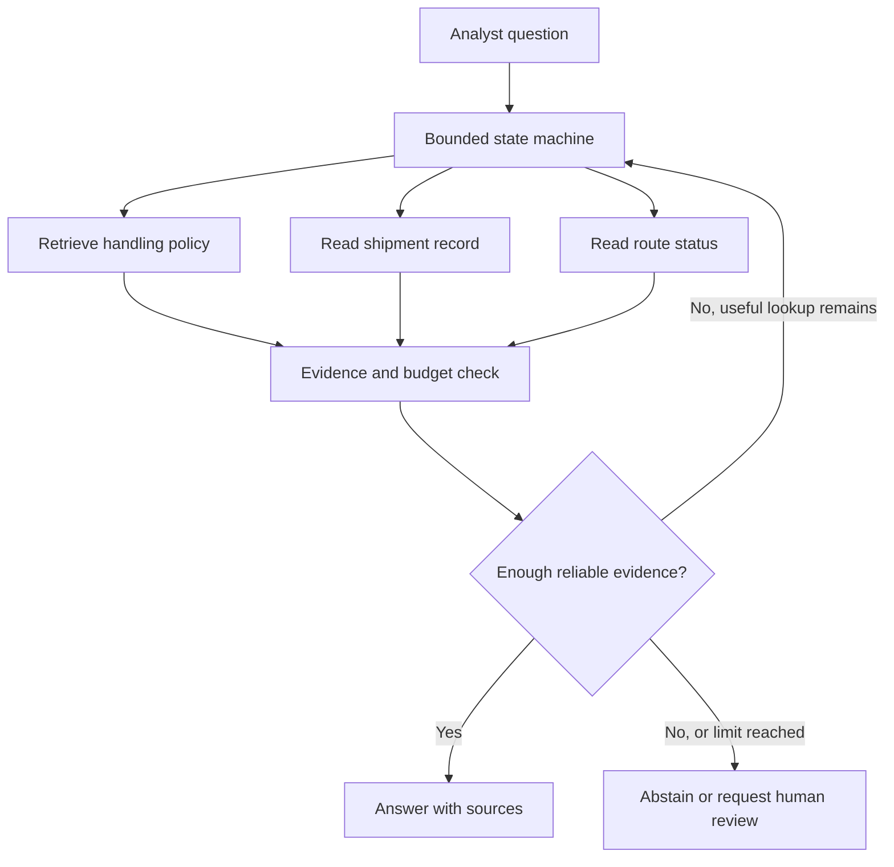

When I think about an operational assistant, I start with a practical question: does it have enough evidence to answer, or should it look something up first? In this article, I explain how agentic Retrieval-Augmented Generation (RAG) makes that choice, derive the decision logic, and build a bounded Python example for a parcel hub analyst handling an exception.

## The business problem

A parcel hub operations analyst may receive a question such as: “Why is parcel PX-4821 delayed, and what should I tell the next shift?” The answer may depend on several kinds of information. A handling policy explains what counts as a delay and how exceptions are escalated. A shipment record gives the parcel’s latest scan. A read-only route-status service shows whether its planned route is running late.

These sources answer different parts of the question. A policy document is not a live shipment record, and a route status is not permission to change a shipment. A standard RAG answer that retrieves a few documents and generates a response may have the policy but miss the current scan. It might still write a plausible explanation, which is exactly the wrong outcome when a colleague needs a reliable handover.

One option is to call every data source for every question. That can increase latency, service load, and cost, while adding irrelevant information to the model’s context. The opposite option, using only the initial retrieval, can leave important facts unchecked. There is also a governance cost: an assistant that blurs the line between describing an exception and taking action is difficult to audit and unsafe to expand.

The operational goal is not maximal autonomy. It is to resolve the question with the smallest set of useful, authorized lookups, show the evidence, and stop or abstain when the available evidence is insufficient. That can reduce repetitive investigation while leaving decisions and changes with a human.

## The idea in plain English

Ordinary RAG follows a mostly fixed path: search a knowledge source, place the best passages beside the question, then ask a language model to respond. Agentic RAG adds a decision step. After reviewing the question and evidence so far, the model can request an allowed lookup, answer, or abstain. The system repeats that cycle only within explicit limits.

The important distinction is **control flow**, not a different kind of retrieval. A RAG system can be agentic when it chooses among retrieval or tool actions based on intermediate results. An “agent” does not need broad permissions, a personality, or the ability to invent new tools.

I model the workflow as a small state machine. Its state contains the original question, evidence collected, elapsed steps, and remaining budgets. At each step, a planner proposes one action from a fixed allowlist. The application validates that action, runs a narrowly scoped reader, adds the result to the evidence, and asks again. An answer or abstention is a terminal state; exhausting the step or token budget is also terminal.

For the parcel example, the allowed actions are policy retrieval, shipment lookup, and read-only route status. The assistant can explain a late arrival from evidence, but it cannot reroute the parcel, alter a scan, or notify a customer. This separation makes the system easier to test and keeps the consequences of a mistaken model decision low.



## How it works: the math, step by step

Decision theory gives a disciplined way to describe when a tool call is worth making. The values in a real deployment need to come from observed operations, not intuition disguised as precision.

### 1. Represent uncertainty about the answer

Suppose the analyst is considering two explanations for a delay: a route disruption, denoted by \(R\), or a missed hub scan, denoted by \(H\). Given the question and current evidence \(E\), the system can represent its uncertainty as probabilities.

$$
P(R\mid E)=0.6,\qquad P(H\mid E)=0.4
$$

In plain English: before checking live route status, the evidence makes a route disruption more likely than a missed scan, but neither explanation is certain.

One common summary of uncertainty is Shannon entropy. For a set of possible explanations \(y\), entropy is:

$$
H(Y\mid E)=-\sum_y P(y\mid E)\log_2 P(y\mid E)
$$

In plain English: entropy is high when probability is spread across several explanations and low when one explanation dominates. It is measured in bits when the logarithm uses base two.

For the probabilities above:

$$
H(Y\mid E)=-0.6\log_2(0.6)-0.4\log_2(0.4)\approx0.971\text{ bits}
$$

In plain English: the current evidence leaves nearly one bit of uncertainty, so a useful additional observation could still change the analyst’s conclusion.

### 2. Estimate the value of information

A tool call is useful only if the information it is expected to provide is worth its operational cost. Let \(L(a,y)\) be the loss from taking answer action \(a\) when the true explanation is \(y\). With current evidence, the least expected loss is:

$$
L_{\mathrm{now}}=\min_a\sum_y P(y\mid E)L(a,y)
$$

In plain English: compare the possible answer choices, weight each choice’s mistake cost by how likely that explanation is, and choose the answer with the smallest expected loss.

If a tool \(T\) can return observation \(z\), the expected loss after using it is:

$$
L_{\mathrm{after}}(T)=\sum_z P(z\mid E)\min_a\sum_y P(y\mid E,z)L(a,y)
$$

In plain English: consider each result the tool might return, update the explanation probabilities, find the best answer for that result, and average the resulting losses.

The expected value of information, after subtracting tool cost \(c_T\), is:

$$
\operatorname{VOI}(T)=L_{\mathrm{now}}-L_{\mathrm{after}}(T)-c_T
$$

In plain English: a lookup is worthwhile when the expected reduction in decision loss is larger than its cost. Tool cost can include latency, API expense, service load, and the analyst’s waiting time, expressed in consistent units.

A positive value is a useful decision signal, not a command to call a tool. The tool must also be authorized, relevant, available within the remaining budgets, and likely to return evidence of adequate quality. A negative value suggests stopping may be better.

### 3. Update beliefs with evidence

When a tool returns a result, Bayes’ rule describes how to update the probability of an explanation:

$$
P(y\mid E,z)=\frac{P(z\mid y,E)P(y\mid E)}{P(z\mid E)}
$$

In plain English: start with the prior probability of an explanation, multiply by how likely the new observation is under that explanation, then normalize by the probability of seeing that observation at all.

This update depends on likelihoods that need evaluation. A route-status service that reports a disruption can raise the probability of a route cause, but a stale status or a route shared by many parcels may be weak evidence. Tool output is evidence to assess, not unquestionable truth.

### 4. Stop when another lookup is not worth its cost

Let \(T\) range over the authorized tools that remain available. A simple stopping rule compares their best net value with a minimum worthwhile threshold:

$$
\max_T \operatorname{VOI}(T)\leq \tau \quad\Longrightarrow\quad \text{stop and answer or abstain}
$$

In plain English: if no remaining lookup is expected to improve the decision enough to justify its cost, stop gathering information. The system still needs a separate evidence threshold to decide whether it can answer at all.

An agent cannot reliably calculate exact VOI from language-model confidence alone. In practice, policies can use measured error costs, lookup latency, historical tool usefulness, and task-specific thresholds. The planner can propose what to inspect; deterministic application logic decides what it is allowed to execute.

### 5. Treat confidence and abstention as separate controls

A calibrated probability of correctness can support an answer threshold:

$$
\text{answer only if }P(\text{answer is correct}\mid E)\geq\theta
$$

In plain English: answer only when the estimated chance of correctness is at least the threshold chosen for this task. Otherwise, state what is missing or request human review.

The threshold should reflect the cost of errors. A low-impact shift note and a safety-critical instruction should not share an arbitrary confidence cutoff. Also, a model’s self-reported confidence is not automatically calibrated. Evaluate predicted confidence against labeled outcomes before relying on it.

### 6. Budget steps, tokens, and latency

Agentic workflows can make repeated calls, so resource bounds are part of correctness. A simple upper bound on tool work is:

$$
N_{\mathrm{tool}}\leq N_{\mathrm{steps}}\leq B_{\mathrm{steps}}
$$

In plain English: tool calls cannot exceed the number of loop iterations, and loop iterations cannot exceed the configured step budget.

If each model call uses \(t_i\) tokens and the total token budget is \(B_{\mathrm{tokens}}\), then:

$$
\sum_{i=1}^{N_{\mathrm{steps}}}t_i\leq B_{\mathrm{tokens}}
$$

In plain English: count prompt and completion tokens across the whole run, and stop when their total reaches the budget. A production adapter should enforce the remaining allowance at request time, not merely inspect it afterward.

For a serial workflow, end-to-end latency is approximately:

$$
T_{\mathrm{total}}=\sum_i T_{\mathrm{model},i}+\sum_j T_{\mathrm{tool},j}+T_{\mathrm{overhead}}
$$

In plain English: each sequential model call and lookup adds time, along with orchestration overhead. This is why a tool that adds little decision value can still make a useful answer worse operationally.

## Implementation in Python

The following Python 3.10+ example separates the model planner from the tools. Protocols make the interfaces vendor-neutral, while an immutable configuration makes the limits visible. The example is an orchestration skeleton: deployment adapters still need authentication, timeouts, logging, schema validation, and provider-specific token metering.

Each planner response contains a single action. The application accepts only three read operations, validates an identifier before shipment calls, bounds the iteration count, and turns limit exhaustion into an explicit abstention. The tool interfaces do not provide mutation methods.

```python
from dataclasses import dataclass
from typing import Literal, Protocol, Sequence


@dataclass(frozen=True)
class Config:
    max_steps: int = 4
    max_tokens: int = 2_000
    policy_limit: int = 3
    max_shipment_id_length: int = 32
    max_tool_result_chars: int = 1_000


@dataclass(frozen=True)
class PolicyChunk:
    text: str
    source: str


@dataclass(frozen=True)
class Shipment:
    shipment_id: str
    status: str
    last_scan: str


Action = Literal["policy", "shipment", "route_status", "answer", "abstain"]


@dataclass(frozen=True)
class Decision:
    action: Action
    rationale: str
    query: str = ""
    shipment_id: str = ""
    response: str = ""
    tokens_used: int = 0


class Planner(Protocol):
    def decide(
        self,
        question: str,
        evidence: Sequence[str],
        remaining_steps: int,
        remaining_tokens: int,
    ) -> Decision: ...


class PolicySearch(Protocol):
    def search(self, query: str, limit: int) -> Sequence[PolicyChunk]: ...


class ShipmentReader(Protocol):
    def get(self, shipment_id: str) -> Shipment | None: ...


class RouteStatusReader(Protocol):
    def get_status(self, shipment_id: str) -> str | None: ...


def valid_shipment_id(value: str, max_length: int) -> bool:
    allowed = set("abcdefghijklmnopqrstuvwxyzABCDEFGHIJKLMNOPQRSTUVWXYZ0123456789-")
    return 0 < len(value) <= max_length and all(char in allowed for char in value)


def format_policy(chunks: Sequence[PolicyChunk], max_chars: int) -> list[str]:
    return [
        f"Policy source: {chunk.source[:200]}. Text: {chunk.text[:max_chars]}"
        for chunk in chunks
    ]


def run_agent(
    question: str,
    planner: Planner,
    policies: PolicySearch,
    shipments: ShipmentReader,
    routes: RouteStatusReader,
    config: Config = Config(),
) -> str:
    evidence: list[str] = []
    tokens_used = 0

    for step in range(config.max_steps):
        remaining_tokens = config.max_tokens - tokens_used
        if remaining_tokens <= 0:
            return "I could not verify the answer within the token budget. Please review."

        decision = planner.decide(
            question=question,
            evidence=evidence,
            remaining_steps=config.max_steps - step,
            remaining_tokens=remaining_tokens,
        )
        if decision.tokens_used < 0 or decision.tokens_used > remaining_tokens:
            return "I could not verify the answer within the token budget. Please review."
        tokens_used += decision.tokens_used

        if decision.action == "answer":
            return decision.response or "I do not have enough evidence to answer."
        if decision.action == "abstain":
            return decision.response or "I could not verify this exception. Please review."

        if decision.action == "policy":
            chunks = policies.search(decision.query[:500], config.policy_limit)
            evidence.extend(
                format_policy(chunks[:config.policy_limit], config.max_tool_result_chars)
            )
        elif decision.action == "shipment":
            shipment_id = decision.shipment_id
            if not valid_shipment_id(shipment_id, config.max_shipment_id_length):
                evidence.append("Shipment lookup was rejected: invalid identifier.")
                continue
            shipment = shipments.get(shipment_id)
            evidence.append(
                (
                    f"Shipment record: id={shipment.shipment_id[:config.max_shipment_id_length]}, "
                    f"status={shipment.status[:200]}, last_scan={shipment.last_scan[:500]}"
                )
                if shipment is not None
                else "Shipment record: no matching parcel was found."
            )
        elif decision.action == "route_status":
            shipment_id = decision.shipment_id
            if not valid_shipment_id(shipment_id, config.max_shipment_id_length):
                evidence.append("Route lookup was rejected: invalid identifier.")
                continue
            status = routes.get_status(shipment_id)
            evidence.append(
                f"Route status for {shipment_id}: {status[:config.max_tool_result_chars]}"
                if status is not None
                else f"Route status for {shipment_id}: unavailable."
            )
        else:
            return "I cannot perform that action. Please review the request."

    return "I reached the lookup limit without enough evidence. Please review."


class DemoPlanner:
    def decide(
        self,
        question: str,
        evidence: Sequence[str],
        remaining_steps: int,
        remaining_tokens: int,
    ) -> Decision:
        if not any(item.startswith("Policy source:") for item in evidence):
            return Decision("policy", "Check the applicable handling rule.", query=question)
        if not any(item.startswith("Shipment record:") for item in evidence):
            return Decision("shipment", "Confirm the latest parcel scan.", shipment_id="PX-4821")
        if not any(item.startswith("Route status") for item in evidence):
            return Decision("route_status", "Check the planned route.", shipment_id="PX-4821")
        return Decision(
            "answer",
            "All three read-only sources were checked.",
            response="The route service reports a disruption. The latest parcel scan is at the origin hub. Review the cited policy and source timestamps before making a handover recommendation.",
        )


class DemoPolicySearch:
    def search(self, query: str, limit: int) -> Sequence[PolicyChunk]:
        return (PolicyChunk("Check route disruption and latest scan before escalation.", "Hub handling policy v3"),)


class DemoShipmentReader:
    def get(self, shipment_id: str) -> Shipment | None:
        return Shipment(shipment_id, "Delayed", "Origin hub, 06:40")


class DemoRouteReader:
    def get_status(self, shipment_id: str) -> str | None:
        return "Disruption reported on scheduled route, updated 06:55"


if __name__ == "__main__":
    print(
        run_agent(
            "Why is parcel PX-4821 delayed?",
            DemoPlanner(),
            DemoPolicySearch(),
            DemoShipmentReader(),
            DemoRouteReader(),
        )
    )
```

The planner proposes; the application executes only allowlisted reads. A production adapter must validate structured output, enforce token and timeout limits, and log under access controls. Bound each tool result before adding it to context.

The step cap makes loops finite; also reject duplicate calls and enforce a wall-clock deadline. Enforce route read-only access at the service-account level, not only in the prompt.

Index policy version and effective date; read only the parcel fields needed. Require answers to separate observed facts from interpretation and cite sources.

## A worked example

Consider a parcel hub analyst asking about parcel PX-4821. The initial text mentions a delay but provides no confirmed cause. A small evaluation set for this kind of question estimates a 60% chance of a route disruption and a 40% chance of a missed scan. For this example, a wrong shift recommendation has a loss of 80 points, and a correct one has zero loss.

If the assistant answers immediately with “route disruption,” the expected loss is:

$$
L_{\mathrm{now}}=(0.6\times0)+(0.4\times80)=32
$$

In plain English: the chosen explanation is wrong in the 40% missed-scan case, giving an expected loss of 32 points.

Suppose a route-status lookup costs 2.5 points when latency and operational overhead are included. Historical evaluation suggests that after using this lookup, the expected probability of a wrong recommendation falls to 10%. The expected remaining loss is:

$$
L_{\mathrm{after}}=0.10\times80=8
$$

In plain English: after the lookup, the expected mistake cost is 8 points because the estimated error probability is 10%.

The net expected value of the route lookup is:

$$
\operatorname{VOI}=32-8-2.5=21.5
$$

In plain English: under these assumptions, route status reduces expected decision loss by 24 points, costs 2.5, and leaves a positive net value of 21.5 points.

The workflow first retrieves the applicable handling policy and reads the shipment record. The policy says which scan sequence qualifies as a delay; the shipment record shows a last scan at the origin hub. The planner then requests route status because it can change which explanation is supported. The read-only service reports a disruption on the scheduled route, and the planner answers that the route disruption is the leading explanation, cites the route observation and the policy, and states that the parcel has not yet received a destination-hub scan.

The answer should not say the parcel will arrive at a particular time unless the source contains a reliable estimate. If the route service is unavailable, the agent should preserve that uncertainty and either explain the confirmed facts or ask the analyst to review it. The arithmetic illustrates a decision rule; its 10% error estimate and cost points must be validated for the operation before being used as thresholds.

## Pitfalls and when not to use it

- **A loop is not automatically an improvement.** If the question can be answered by one high-quality retrieval, ordinary RAG is simpler, quicker, and easier to evaluate.
- **Do not treat model confidence as a calibrated probability.** Measure confidence against labeled outcomes, stratified by question type and source quality.
- **A retrieved passage can be stale or inapplicable.** Include effective dates, versions, access controls, and source identifiers. Retrieval relevance alone does not establish policy authority.
- **Tool output can be incomplete.** Define what “not found,” “unavailable,” and “stale” mean, and make those states visible rather than converting them into confident prose.
- **Repeated or circular calls waste time.** Bound calls and steps, detect duplicate requests, and stop on a deadline as well as a token limit.
- **Prompt instructions are not permissions.** Enforce read-only access and resource-level authorization in the tools themselves. Never expose a write action merely because a model promises to use it carefully.
- **Sensitive data can spread into prompts and logs.** Minimize returned fields, redact identifiers where practical, and apply retention and access rules to traces.
- **It may be the wrong design for predictable workflows.** If the same checks are required every time, a conventional deterministic workflow with explicit branches is usually more consistent than asking a model to choose each step.

I would not use agentic RAG where a wrong answer has high consequences and the sources cannot support dependable verification, or where the assistant would need broad write access to be useful. In those cases, keep a person in control, or use a deterministic process with approved decision rules.

## Measuring success in production

Measure the whole workflow, not just whether the final prose sounds convincing. Start with a labeled set of real, privacy-reviewed questions and expected source evidence. Compare the agent with the simplest baseline, such as a fixed retrieval pipeline or the existing analyst process.

Useful measures include:

- **Answer correctness and evidence support:** share of answers whose factual claims are supported by current, relevant sources.
- **Abstention quality:** how often the system abstains on genuinely unanswerable cases, and how often it abstains unnecessarily.
- **Retrieval and tool usefulness:** percentage of calls that add evidence used in the final answer; rate of irrelevant, duplicate, unavailable, or stale results.
- **Operational cost:** model and tool cost per resolved question, tokens per run, and average number of lookups.
- **Latency:** median and tail response time, including timeouts and retries.
- **Human workload:** analyst review time, correction rate, and escalation volume compared with the current process.
- **Safety and access:** unauthorized-call attempts blocked, sensitive-data exposure incidents, and audit-log completeness.

Set a service target for correctness, latency, and cost before deployment. Review failures by cause: retrieval miss, source quality, wrong tool choice, invalid output, or unsupported generation. Changes to prompts, models, indexes, or tools should be evaluated against the same examples and a held-out set. A positive online impact is a measured reduction in effort or errors without an unacceptable increase in risk, not simply more tool use.

## Checklist

- Define the user’s decision and the cost of a wrong answer.
- Compare against ordinary RAG and a deterministic workflow first.
- Limit the planner to a typed, authorized action list.
- Keep operational tools read-only unless a separately governed workflow is required.
- Track evidence sources, policy versions, and data timestamps.
- Set explicit step, token, latency, and result-size budgets.
- Test uncertainty, missing data, stale data, and tool failures.
- Calibrate answer and abstention behavior on representative examples.
- Monitor answer quality, cost, latency, and human corrections after release.
- Give analysts a clear path to review and report an unsupported answer.

## Final thought

Agentic RAG is most useful when an answer depends on a few different sources and the next lookup genuinely depends on what is already known. Keeping the workflow small, read-only, measurable, and willing to stop makes it more useful than giving it open-ended autonomy. For related capabilities, see [AI automation and agentic workflows](/services/#ai-automation-agentic-workflow), and [contact me](/contact/) to discuss a practical use case. For a deeper look at the retrieval layer, read [Hybrid Search RAG: from concept to implementation](/posts/2026-10-22-hybrid-rag-from-concept-to-implementation/).

For other RAG architectures, read [HybridRAG](/posts/2026-10-22-hybrid-rag-from-concept-to-implementation/),[GraphRAG](/posts/2026-11-01-graphrag-concept-to-implementation/), [Corrective RAG](/posts/2026-10-30-corrective-rag-crag-concept-to-implementation/), and [Multimodal RAG](/posts/2026-11-01-multimodal-rag-concept-to-implementation/).
