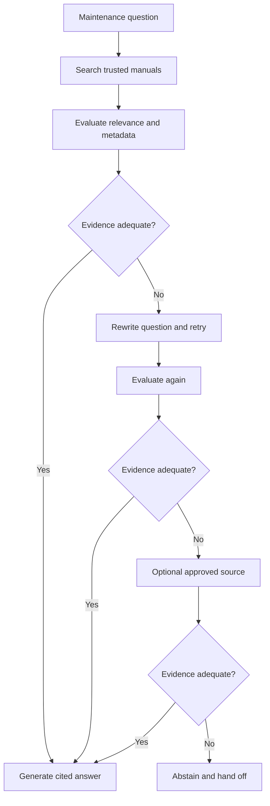

When I design a retrieval-augmented assistant, I do not assume a search result is good evidence just because a search engine returned it. I will show how Corrective RAG (CRAG) can detect weak retrieval, try a bounded correction, and hand off a safety question rather than inventing certainty.

## The business problem

A maintenance team asks, “What should I do before opening the access panel on the conveyor?” The assistant retrieves a procedure from an old manual. It looks relevant because it mentions the same model of conveyor, but it may describe an earlier revision, omit a later lockout step, or apply to another site.

A conventional Retrieval-Augmented Generation (RAG) pipeline often has a simple contract: search, attach the top results to the prompt, then generate. That contract treats retrieval as a successful operation whenever it returns something. It does not answer the more important question: are these results relevant and trustworthy enough for this particular answer?

The cost of getting this wrong is not just a low-quality response. A confident but unsupported instruction can lead to unsafe work, downtime, rework, or loss of trust in the assistant. At the other extreme, sending every question to a human makes the system slow and expensive, and gives staff little reason to use it.

The design problem is therefore a decision under uncertainty. The system needs to distinguish adequate evidence from inadequate evidence, select a proportionate correction, and stop when it cannot establish a safe basis for answering. It also needs to respect the organisation’s approved sources. A public web search is not an acceptable default for internal safety procedures.

This motivates a broad family of corrective retrieval patterns. CRAG is also used for a particular research proposal, so I will distinguish the general pattern from that proposal.

## The idea in plain English

Corrective RAG adds a checkpoint between retrieval and answer generation. First, the system searches its trusted corpus. Then an evaluator checks whether the retrieved material appears relevant to the question. If it does, the system generates an answer grounded in that material. If not, it tries to repair the retrieval, perhaps by rewriting the question and searching again.

If a second search still lacks sufficient evidence, the system may consult a separately approved source. That could be a controlled document service or a current manufacturer repository, provided that access, freshness, and source identity are governed. “Search the web” is not a universal safety net: public pages may be stale, unverified, or outside policy. If no approved source supports an answer, the assistant abstains and routes the question to a qualified person.

The evaluator is a decision aid, not a fact-checking oracle. A relevance score can indicate that passages seem to address the question. It cannot prove that the manual is current, that the procedure is correct, or that the generated answer follows it. Those properties require separate controls, such as document-version metadata, access rules, citations, and review for high-risk actions.

The term *Corrective RAG* is used broadly for systems that inspect and correct weak retrieval. The CRAG paper/proposal describes a more specific approach: a retrieval evaluator assesses retrieved knowledge, then corrective actions include web search when knowledge is inadequate and refinement that separates useful from less useful information. These are design ideas, not a guarantee that every external source is suitable or that all systems must use the same evaluator. The implementation below uses bounded query rewriting and an optional approved source.

This design is related to [hybrid search RAG](/posts/2026-10-22-hybrid-rag-from-concept-to-implementation/). Hybrid retrieval can improve the first set of candidates by combining lexical and semantic search. Corrective RAG addresses what happens after that set is returned: do we have enough evidence to proceed?



## How it works: the math, step by step

### 1. Represent evidence quality

Let a user question be \(q\), and let the retriever return a set of passages \(D=\{d_1,\ldots,d_n\}\). An evaluator assigns each passage a relevance estimate \(r_i\) between zero and one.

$$
r_i = P(\text{passage } d_i \text{ is useful for answering } q \mid q,d_i)
$$

In plain English: \(r_i\) is the evaluator’s estimated probability that passage \(i\) helps answer this question. In practice, the estimate may come from a classifier, a language model with a constrained rubric, or a calibrated combination of signals. It is not a probability that the passage is true.

When multiple passages are present, one simple aggregate is the best-passage score:

$$
R(q,D)=\max_{1\leq i\leq n} r_i
$$

In plain English: this score asks whether at least one retrieved passage looks useful. It is deliberately simple, but it can be fooled by one apparently relevant passage surrounded by conflicting evidence.

Another option is a weighted aggregate that rewards several useful passages:

$$
R_w(q,D)=\frac{\sum_{i=1}^{n} w_i r_i}{\sum_{i=1}^{n} w_i}
$$

In plain English: assign each passage a weight \(w_i\), such as a rank or source-quality weight, then average relevance. With no passages, define the score as zero. A real system should also account for contradictions and outdated versions rather than let an average hide them.

All numeric thresholds and relevance values in this article are illustrative. They must be selected and calibrated against representative queries and expert judgements for the actual domain.

### 2. Turn the score into a decision

Choose a threshold \(\tau\), and accept the evidence only when the score meets it:

$$
\text{adequate}(q,D)=
\begin{cases}
\text{yes}, & R(q,D)\geq\tau\\
\text{no}, & R(q,D)<\tau
\end{cases}
$$

In plain English: a score at or above the threshold permits grounded generation; a lower score triggers correction or abstention. Validate that the score and threshold are finite and between zero and one.

A low threshold accepts more retrieved sets. That can reduce retries and human handoffs, but it increases the chance that weak evidence reaches the generator. A high threshold rejects more borderline evidence. That may improve caution, but can cause unnecessary retries, latency, and abstentions. There is no universally correct setting. For safety procedures, the cost of an unsupported instruction may justify a conservative threshold and additional version checks.

### 3. Make the decision in expected-cost terms

Threshold selection can be framed as a risk trade-off. Let \(p\) be the calibrated probability that the evidence is insufficient, \(C_a\) the cost of answering from insufficient evidence, and \(C_r\) the cost of a retry or review.

$$
\mathbb{E}[C_{\text{answer}}]=pC_a
\qquad\text{and}\qquad
\mathbb{E}[C_{\text{correct}}]=C_r
$$

In plain English: answer risk grows with the chance of weak evidence and the consequence of getting it wrong; correction has a cost even when it succeeds. When the expected answer cost is greater than the correction cost, retry or hand off. In high-impact settings, \(C_a\) is large, so it is rational to correct more often.

This is not a claim that a model’s raw score is calibrated. Calibration means, for example, that among decisions assigned confidence near 0.8, roughly 80 percent meet the defined evidence-quality criterion in a representative evaluation set. Without that check, a score is just a score. Cost values also need to reflect operational reality, not arbitrary numbers chosen to make a preferred design look optimal.

### 4. Correct retrieval, then stop

If the initial evidence is weak, a rewrite can make the query more specific. It might expand an equipment nickname into a model number, add a relevant site, or separate a compound question. A rewrite is not guaranteed to improve retrieval, so each attempt must be evaluated using the same evidence criteria.

Set a maximum number \(m\) of rewrites. The number of primary searches is then bounded:

$$
N_{\text{primary}}\leq m+1
$$

In plain English: one initial search plus at most \(m\) rewritten searches prevents an unending correction loop. An optional approved fallback adds at most one more search in this design. A timeout, exhausted retry budget, or still-inadequate evidence must lead to a defined outcome, not an implicit best guess.

The correction action should also match the failure. A query that omits an asset identifier may benefit from rewriting. A corpus with no current procedure needs document ingestion or a human owner, not repeated search. If two sources conflict, the system should surface that conflict rather than average scores and silently choose one.

## Implementation in Python

The Python 3.10+ sketch keeps orchestration independent of search and language-model vendors. Protocols define adapters for retrieval, evaluation, rewriting, an approved source, and answer generation.

The evaluator returns a score from zero to one. Production rubrics can also consider version, authority, and contradictions; keep these checks visible rather than hiding them in one opaque confidence number.

```python
from dataclasses import dataclass
from math import isfinite
from typing import Protocol, Sequence


@dataclass(frozen=True)
class Evidence:
    text: str
    source: str
    revision: str


@dataclass(frozen=True)
class RagConfig:
    threshold: float = 0.75
    max_rewrites: int = 1
    top_k: int = 5

    def __post_init__(self) -> None:
        if not isfinite(self.threshold) or not 0.0 <= self.threshold <= 1.0:
            raise ValueError("threshold must be finite and between 0 and 1")
        if self.max_rewrites < 0:
            raise ValueError("max_rewrites cannot be negative")
        if self.top_k < 1:
            raise ValueError("top_k must be at least 1")


class Retriever(Protocol):
    def search(self, query: str, limit: int) -> Sequence[Evidence]: ...


class Rewriter(Protocol):
    def rewrite(self, question: str, prior_query: str) -> str: ...


class EvidenceEvaluator(Protocol):
    def score(self, question: str, evidence: Sequence[Evidence]) -> float: ...


class Answerer(Protocol):
    def answer(self, question: str, evidence: Sequence[Evidence]) -> str: ...


@dataclass(frozen=True)
class Outcome:
    status: str
    message: str
    evidence: tuple[Evidence, ...] = ()
    query_used: str = ""


def validate_score(score: float) -> float:
    if not isfinite(score) or not 0.0 <= score <= 1.0:
        raise ValueError("evidence score must be finite and in [0, 1]")
    return score


class CorrectiveRAG:
    def __init__(
        self,
        primary: Retriever,
        rewriter: Rewriter,
        evaluator: EvidenceEvaluator,
        answerer: Answerer,
        config: RagConfig,
        approved_fallback: Retriever | None = None,
    ) -> None:
        self.primary = primary
        self.rewriter = rewriter
        self.evaluator = evaluator
        self.answerer = answerer
        self.config = config
        self.approved_fallback = approved_fallback

    def run(self, question: str) -> Outcome:
        if not question.strip():
            return Outcome("invalid", "Please provide a question.")

        query = question.strip()
        evidence: Sequence[Evidence] = ()
        for attempt in range(self.config.max_rewrites + 1):
            try:
                evidence = self.primary.search(query, self.config.top_k)
                score = (
                    validate_score(self.evaluator.score(question, evidence))
                    if evidence
                    else 0.0
                )
            except (TimeoutError, ConnectionError):
                return Outcome(
                    "unavailable",
                    "Trusted retrieval is unavailable; route this question for review.",
                    query_used=query,
                )

            if score >= self.config.threshold:
                return self._answer(question, evidence, query)

            if attempt < self.config.max_rewrites:
                try:
                    revised = self.rewriter.rewrite(question, query).strip()
                except (TimeoutError, ConnectionError):
                    return Outcome(
                        "unavailable",
                        "Query rewriting is unavailable; route this question for review.",
                        tuple(evidence),
                        query,
                    )
                if revised:
                    query = revised

        if self.approved_fallback is not None:
            try:
                fallback = self.approved_fallback.search(query, self.config.top_k)
                score = (
                    validate_score(self.evaluator.score(question, fallback))
                    if fallback
                    else 0.0
                )
                if score >= self.config.threshold:
                    return self._answer(question, fallback, query)
            except (TimeoutError, ConnectionError):
                return Outcome(
                    "unavailable",
                    "The approved fallback source is unavailable; route this question for review.",
                    tuple(evidence),
                    query,
                )

        return Outcome(
            "abstain",
            "I could not verify adequate evidence. Please ask the maintenance owner.",
            tuple(evidence),
            query,
        )

    def _answer(
        self, question: str, evidence: Sequence[Evidence], query: str
    ) -> Outcome:
        try:
            text = self.answerer.answer(question, evidence)
        except (TimeoutError, ConnectionError):
            return Outcome(
                "unavailable",
                "Answer generation is unavailable; route this question for review.",
                tuple(evidence),
                query,
            )
        return Outcome("answered", text, tuple(evidence), query)
```

An empty result scores zero, and an invalid evaluator score raises an error instead of being clamped. Network timeouts produce an explicit handoff outcome. Other programming and data-integrity errors remain visible for diagnosis.

The fallback is optional by construction. In production, its adapter should enforce an allowlist and return source identity and revision metadata. The answerer should cite the supplied evidence and be instructed not to use ungrounded model memory. The application should still validate generated citations and apply separate safety rules before showing any actionable instruction.

Here is a short generic call site. The concrete adapters are supplied by the application, not tied to a particular vendor.

```python
config = RagConfig(threshold=0.78, max_rewrites=1, top_k=5)
assistant = CorrectiveRAG(
    primary=manual_search,
    rewriter=query_rewriter,
    evaluator=maintenance_evidence_evaluator,
    answerer=grounded_answerer,
    config=config,
    approved_fallback=current_procedure_service,
)

outcome = assistant.run("What should I do before opening the conveyor panel?")
if outcome.status == "answered":
    display(outcome.message, sources=outcome.evidence)
else:
    send_to_maintenance_review(outcome.message, outcome.evidence)
```

Show source details, including revision and effective date, so a technician can inspect the procedure. This is an orchestration sketch, not a certified safety system. Production requires approved source lists, currentness rules, staffed handoffs, and answer checks.

## A worked example

Suppose a maintenance assistant receives the question: “What must I do before opening the conveyor access panel?” The first search returns two passages. For illustration, the evaluator assigns relevance values \(0.62\) and \(0.41\). Using the maximum-score rule:

$$
R_0=\max(0.62,0.41)=0.62
$$

In plain English: the strongest initial passage scores 0.62. With an illustrative threshold of \(\tau=0.75\), this evidence is not adequate, so the assistant does not answer yet.

The rewriter adds the asset’s known model identifier and the phrase “isolation procedure.” The next primary search returns passages scored \(0.84\) and \(0.67\):

$$
R_1=\max(0.84,0.67)=0.84\geq0.75
$$

In plain English: the strongest passage now clears the threshold, so the system can proceed to generation, subject to separate source-freshness and safety checks. The change in score does not prove that the rewrite found the correct procedure; it only passes this illustrative evaluator’s gate.

Now consider the risk trade-off with illustrative costs. Suppose an unsupported answer has cost \(C_a=100\) units, a correction attempt costs \(C_r=3\) units, and a calibrated estimate of inadequate evidence is \(p=0.08\).

$$
\mathbb{E}[C_{\text{answer}}]=0.08\times100=8
\qquad\text{and}\qquad
\mathbb{E}[C_{\text{correct}}]=3
$$

In plain English: under these assumed costs, answering immediately has expected cost 8 units, while attempting correction costs 3. Correction is preferable. The numbers are illustrative decision inputs, not measured outcomes or a universal business case.

If the rewrite still scores below 0.75, the system may query the approved current-procedure service. If that service also returns insufficient evidence, the outcome is abstention and handoff. The assistant should explain that it could not verify the procedure and direct the worker to the maintenance owner. That is not a failure of the workflow. It is the intended safe result when evidence is missing.

## Pitfalls and when not to use it

- **A relevance score is not a truth score.** A stale procedure can be highly relevant to the wording of a question. Check revision, effective date, asset identity, and authority separately.
- **Do not let one threshold hide different risks.** A general equipment definition and an instruction that could expose a worker to moving machinery do not have the same consequence. Use risk tiers or mandatory human review for high-impact questions.
- **Avoid ungoverned web search.** Public search may return unofficial copies, outdated instructions, or pages that conflict with internal policy. Use it only when the organisation has approved the source, defined freshness requirements, and decided how its content can be used.
- **A rewrite can drift.** The rewritten question may accidentally remove a constraint, change a model number, or broaden the scope. Preserve the original question and evaluate the rewritten results against it.
- **Retries cost time and money.** Each extra search and evaluator call adds latency and may add model cost. Set a small fixed retry budget and measure whether each retry actually improves evidence quality.
- **Weak evaluation creates false confidence.** Language-model judges can be inconsistent and can reward superficial keyword overlap. Test them against expert-labelled cases, check calibration, and monitor disagreement.
- **Conflicting evidence needs a conflict path.** A maximum score can pass one strong-looking document while another contradicts it. Compare versions and sources, detect disagreement, and escalate when it matters.
- **Abstention needs an operational owner.** A handoff queue without staffing, service levels, and a feedback process merely moves the failure somewhere less visible.

Corrective RAG may be unnecessary for a tightly controlled corpus, validated narrow retrieval, and low-risk answers. It is also the wrong first fix for an incomplete or poorly maintained corpus. Improve ingestion, ownership, and metadata before adding model calls to compensate for missing information.

## Measuring success in production

I would measure the corrective system as a decision process, not only as a chatbot. Useful metrics include:

- **Evidence adequacy precision and recall:** among accepted evidence sets, how often did experts judge them adequate, and how many adequate sets were unnecessarily rejected?
- **Calibration error:** do score bands correspond to observed adequacy rates on a representative, reviewed sample?
- **Unsupported-answer rate:** how often does an answer contain a material claim not supported by its cited evidence? Track high-risk categories separately.
- **Source freshness and conflict rate:** how frequently does retrieval surface expired revisions or documents that disagree?
- **Correction yield:** what share of rewrites or approved-source lookups find adequate evidence? If yield is low, inspect query understanding and corpus coverage.
- **Abstention and handoff rates:** how often does the assistant stop, how long does the human queue take, and do users receive a useful next step?
- **Latency and cost per resolved question:** include retrieval, evaluator, rewrite, fallback, generation, and human review rather than reporting model-token cost alone.
- **Safety incidents and near misses:** use the organisation’s established incident and review processes. Do not treat a low incident count as proof of safety without considering exposure and reporting quality.

Review a sample of accepted, corrected, and abstained cases with maintenance experts. Include hard cases such as obsolete revisions, near-duplicate equipment names, conflicting procedures, and questions with missing asset context. Record the evaluator version, threshold, query variants, retrieved document identifiers, and decision reason so that a result can be reproduced.

Threshold changes should follow a controlled evaluation. Compare risk-weighted false acceptance against false rejection and operational costs. Monitor after deployment for changes in document collections, query patterns, model behaviour, and staff workflows. The goal is not to maximise the number of answered questions; it is to provide useful answers when evidence supports them and fail safely when it does not.

## Checklist

- Define which questions the assistant may answer and which require a person.
- Curate trusted sources, revision metadata, access rules, and freshness ownership.
- Choose an evidence rubric and evaluate it against expert-labelled examples.
- Calibrate scores and set thresholds according to the consequences of errors.
- Keep rewrites and external lookups within a finite, observable budget.
- Allow only approved fallback sources; do not make public web search an automatic default.
- Require citations and verify that cited passages support the answer.
- Handle empty results, invalid scores, timeouts, conflicts, and exhausted retries explicitly.
- Staff the handoff process and feed reviewed outcomes back into retrieval improvements.
- Monitor evidence quality, safety, latency, cost, and human workload after release.

## Final thought

Corrective RAG makes a useful distinction: retrieving documents is not the same as having enough evidence to answer. A bounded evaluator-and-correction loop can improve resilience, but it does not replace authoritative documents, source governance, or human judgement where safety is at stake.

If you are planning an internal assistant or a governed RAG workflow, see my [enterprise generative AI services](/services/#enterprise-generative-ai) or [contact me](/contact/) to discuss the problem and its constraints.

For related approaches, read  [HybridRAG](/posts/2026-10-22-hybrid-rag-from-concept-to-implementation/), [GraphRAG](/posts/2026-11-01-graphrag-concept-to-implementation/), [Agentic RAG](/posts/2026-10-25-agentic-rag-concept-to-implementation/), and [Multimodal RAG](/posts/2026-11-01-multimodal-rag-concept-to-implementation/).
