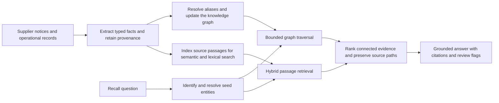

I have seen a familiar failure mode in knowledge assistants: every relevant fact exists somewhere, but it is split across product records, supplier notices, facility lists, and service documents. In this post, I will show how graph-aware retrieval connects those facts, why its mathematics helps with multi-step questions, and how to implement a small, auditable recall-tracing workflow without pretending that a graph removes the need for good data.

## The business problem

Imagine a spare-parts company receives a supplier notice about a defective component batch. The affected component appears under supplier-specific part numbers, is fitted into several product models, and may have moved through multiple facilities. Service bulletins describe repair actions, while product and shipment records contain the actual operational links.

A person investigating the notice must answer questions such as: Which products contain this component? Which facilities handled affected stock? Which service bulletins apply? What evidence supports each answer? A keyword search can find the notice, and vector search may find semantically similar guidance, but neither necessarily follows a chain such as supplier → component → product → facility → bulletin.

When people do this manually, they repeat searches, reconcile naming differences, and risk missing a link. The operational cost is time and inconsistent coverage. A false positive can trigger unnecessary checks; a missed relationship can leave an affected item outside review. This is a decision-support problem, not an invitation to let a language model make a safety decision. Final scope and actions belong to accountable staff using source records.

## The idea in plain English

Represent the facts as a typed graph. Nodes are entities such as suppliers, components, products, facilities, and bulletins. Edges are typed relationships such as `SUPPLIES`, `CONTAINS`, `STORED_AT`, and `ADDRESSES`. Each relationship carries provenance: the source record, its identifier, an effective date, and, where useful, a confidence or status.

When a user asks about a recall, first identify the component and supplier mentioned. Resolve aliases such as an internal part code and a supplier's catalogue code to the same canonical entity only when evidence supports the match. Then find relevant documents with both semantic and exact-term search, and traverse a bounded number of approved graph relationships from the resolved entities. Return the connected records and their source evidence, not just a fluent summary.

The graph does not replace documents. A document may explain an exception or contain nuance not represented by an edge. Conversely, graph relationships make it easier to follow a chain across structured records. The answer should combine both, state the path that led to each result, and expose uncertainty for review.

GraphRAG is a broad label for retrieval-augmented generation that uses a graph as part of retrieval, organization, or context construction. It does not imply one fixed algorithm. Microsoft's GraphRAG is a particular approach that extracts entities and relationships, builds communities, and can generate community summaries for global, corpus-level questions. That indexing and summarization process can add substantial model and storage costs. Other graph-based RAG systems use direct traversal, graph queries, vector search over graph-linked passages, or combinations of these, and need not create communities or summaries. The design below uses bounded local traversal and hybrid evidence retrieval, not the Microsoft community-summary method.



In plain English, the diagram shows two complementary indexes built from the same source records. At question time, entity resolution steers graph traversal and document retrieval; their evidence is combined before an answer is written.

## How it works: the math, step by step

### 1. Model entities, relations, and evidence

Let the graph be a directed, typed multigraph. A multigraph permits more than one relationship between the same pair of entities, which is useful when several source records support or qualify a connection.

$$
G=(V,E,\tau_V,\tau_E,\pi)
$$

In plain English: V is the set of entities, E is the set of relationship records, τ assigns types to entities and edges, and π stores provenance for each edge. Provenance is part of the evidence model, not an optional decoration.

For example, one edge might state that product P-410 contains component C-77. Its provenance points to a bill-of-materials record, with a revision and effective date. If a later revision supersedes that record, the graph should preserve the history or clearly mark which version is current. The graph should not flatten contradictory source records into an unqualified fact.

### 2. Resolve names into canonical entities

A query and a source record may use different names for the same object. Entity resolution compares candidate mentions using appropriate signals. One simple model combines normalized string similarity, identifier agreement, and context compatibility:

$$
M(q,e)=w_s S(q,e)+w_i I(q,e)+w_c C(q,e), \qquad w_s+w_i+w_c=1
$$

Read it as: the match score M for mention q and entity e is a weighted combination of string similarity S, identifier agreement I, and context compatibility C. Each weight controls that signal's influence, and the weights sum to one.

A threshold can route high-confidence matches automatically and send borderline cases to review. Exact identifiers should usually outweigh a loose name resemblance, but an identifier is only reliable if its namespace is known. A part code in one supplier's system can collide with an unrelated code elsewhere. The implementation must therefore preserve namespaces and avoid merging entities solely because their labels look alike.

### 3. Traverse the graph without losing direction or meaning

For a focused recall question, a typed, bounded traversal is often easier to explain than an unconstrained walk. If the seed is a recalled component, allowed paths might be `COMPONENT → CONTAINS ← PRODUCT → STORED_AT → FACILITY` and `COMPONENT → ADDRESSES ← BULLETIN`. Every hop must follow an approved edge type and direction, and a maximum depth limits irrelevant expansion.

For a broader question where several paths may matter, personalized PageRank is one option. Convert edge strengths leaving each node into transition probabilities. Let P be the resulting row-normalized transition matrix, and let s be a probability distribution concentrated on the query's seed entities.

$$
r_{t+1}=(1-\alpha)s+\alpha P^{\mathsf T}r_t
$$

In plain English: at each iteration, retain a fraction 1−α of the ranking at the query seeds, and distribute the remaining α fraction over graph links. The transpose moves probability along the outgoing transitions under this column-vector convention.

The update is a damped fixed-point iteration. It can rank entities connected through multiple paths while keeping the result anchored to the query. A dangling node has no outgoing edges, so its probability mass needs a defined policy, commonly redistribution to the seed distribution. PageRank is not automatically the right answer: for a small, tightly specified recall workflow, an auditable typed traversal may be more predictable.

### 4. Combine graph relevance and document relevance

Graph relevance and vector similarity are different quantities. A cosine score is not on the same scale as a traversal rank, so adding raw values can silently give one source disproportionate influence. A simple, inspectable approach converts each retrieval method into a rank and combines reciprocal ranks:

$$
H(x)=\frac{\lambda_v}{k+r_v(x)}+\frac{\lambda_g}{k+r_g(x)}+\frac{\lambda_l}{k+r_l(x)}
$$

In plain English: H scores evidence item x by adding its discounted rank contributions from vector, graph, and lexical retrieval. A method that did not return x contributes zero; λ values tune the channels, and k reduces the advantage of a single very high rank.

This is a weighted reciprocal-rank fusion score, not a probability that the evidence is true. Keep evidence identity stable when deduplicating results, and retain every origin path. A passage retrieved by vector search and attached to a graph-matched component may deserve a stronger ranking, but its source record still determines whether it is authoritative and current.

Finally, generate only from a compact set of selected evidence, with citations and explicit unresolved questions. The model's prose is a presentation layer. The evidence graph and source records remain the basis for the decision.

## Implementation in Python

The example below is vendor-neutral and uses only the Python standard library. It defines typed domain records, protocols for external services, canonicalizes conservative name variants, traverses a small graph, and fuses already-ranked evidence. A production adapter would implement the protocols using a graph store, search service, and language model. The deterministic functions are directly runnable and can be tested independently.

```python
from __future__ import annotations

from dataclasses import dataclass
from typing import Protocol, Sequence
import re


@dataclass(frozen=True)
class GraphRAGConfig:
    max_depth: int = 3
    traversal_edge_types: tuple[str, ...] = ("CONTAINS", "STORED_AT", "ADDRESSES")
    fusion_constant: int = 20
    vector_weight: float = 1.0
    graph_weight: float = 1.0
    lexical_weight: float = 0.7


@dataclass(frozen=True)
class Entity:
    entity_id: str
    entity_type: str
    label: str
    aliases: tuple[str, ...] = ()


@dataclass(frozen=True)
class Edge:
    source_id: str
    target_id: str
    relation: str
    source_record: str
    effective_date: str


@dataclass(frozen=True)
class Passage:
    passage_id: str
    text: str
    source_record: str
    entity_ids: tuple[str, ...]


@dataclass(frozen=True)
class Evidence:
    passage: Passage
    score: float
    graph_path: tuple[str, ...]


class Embedder(Protocol):
    def embed(self, text: str) -> Sequence[float]: ...


class GraphStore(Protocol):
    def entities_matching(self, mention: str) -> Sequence[Entity]: ...
    def neighbors(self, entity_id: str, relation_types: Sequence[str]) -> Sequence[Edge]: ...


class PassageIndex(Protocol):
    def search_vector(self, vector: Sequence[float], limit: int) -> Sequence[Passage]: ...
    def search_lexical(self, text: str, limit: int) -> Sequence[Passage]: ...
    def search_entities(self, entity_ids: Sequence[str], limit: int) -> Sequence[Passage]: ...


class AnswerModel(Protocol):
    def answer(self, question: str, evidence: Sequence[Evidence]) -> str: ...


def normalize_name(value: str) -> str:
    """Normalize punctuation and whitespace without erasing identifier meaning."""
    return " ".join(re.findall(r"[a-z0-9]+", value.casefold()))


def resolve_exact_alias(mention: str, entities: Sequence[Entity]) -> Entity | None:
    """Resolve only an exact normalized label or alias; leave fuzzy matches for review."""
    key = normalize_name(mention)
    matches = {
        entity.entity_id: entity
        for entity in entities
        if key and key in {normalize_name(entity.label), *(normalize_name(a) for a in entity.aliases)}
    }
    if len(matches) == 1:
        return next(iter(matches.values()))
    return None


def traverse(
    graph: GraphStore,
    seed_ids: Sequence[str],
    config: GraphRAGConfig,
) -> dict[str, tuple[str, ...]]:
    """Return reachable entity IDs with one shortest, source-record path."""
    paths = {seed_id: (seed_id,) for seed_id in seed_ids}
    frontier = list(seed_ids)
    for _ in range(config.max_depth):
        next_frontier: list[str] = []
        for entity_id in frontier:
            for edge in graph.neighbors(entity_id, config.traversal_edge_types):
                if edge.source_id == entity_id:
                    neighbor_id = edge.target_id
                elif edge.target_id == entity_id:
                    neighbor_id = edge.source_id
                else:
                    continue
                if neighbor_id in paths:
                    continue
                paths[neighbor_id] = paths[entity_id] + (edge.source_record, neighbor_id)
                next_frontier.append(neighbor_id)
        frontier = next_frontier
        if not frontier:
            break
    return paths


def fuse_rankings(
    vector_ids: Sequence[str],
    graph_ids: Sequence[str],
    lexical_ids: Sequence[str],
    config: GraphRAGConfig,
) -> dict[str, float]:
    """Weighted reciprocal-rank fusion over evidence IDs, with one-based ranks."""
    scores: dict[str, float] = {}
    channels = (
        (vector_ids, config.vector_weight),
        (graph_ids, config.graph_weight),
        (lexical_ids, config.lexical_weight),
    )
    for ranked_ids, weight in channels:
        for rank, evidence_id in enumerate(ranked_ids, start=1):
            scores[evidence_id] = scores.get(evidence_id, 0.0) + weight / (
                config.fusion_constant + rank
            )
    return scores


def retrieve_evidence(
    question: str,
    seed_mentions: Sequence[str],
    graph: GraphStore,
    embedder: Embedder,
    index: PassageIndex,
    config: GraphRAGConfig,
    limit: int = 10,
) -> list[Evidence]:
    """Retrieve passages, add graph context, and return a fused evidence list."""
    entities: list[Entity] = []
    for mention in seed_mentions:
        entities.extend(graph.entities_matching(mention))
    seeds = [resolve_exact_alias(mention, entities) for mention in seed_mentions]
    seed_ids = list(dict.fromkeys(entity.entity_id for entity in seeds if entity is not None))
    paths = traverse(graph, seed_ids, config)

    vector_hits = list(index.search_vector(embedder.embed(question), limit))
    lexical_hits = list(index.search_lexical(question, limit))
    graph_hits = list(index.search_entities(tuple(paths), limit))
    unique_passages = {p.passage_id: p for p in vector_hits + lexical_hits + graph_hits}
    vector_ids = [p.passage_id for p in vector_hits]
    lexical_ids = [p.passage_id for p in lexical_hits]
    graph_ids = list(dict.fromkeys(p.passage_id for p in graph_hits))
    scores = fuse_rankings(vector_ids, graph_ids, lexical_ids, config)

    evidence = [
        Evidence(
            passage=passage,
            score=scores.get(passage_id, 0.0),
            graph_path=next(
                (paths[entity_id] for entity_id in passage.entity_ids if entity_id in paths),
                (),
            ),
        )
        for passage_id, passage in unique_passages.items()
    ]
    return sorted(evidence, key=lambda item: item.score, reverse=True)[:limit]
```

`resolve_exact_alias` deliberately returns no result when an alias maps ambiguously. A production resolver can use the weighted model above, but should emit a confidence and an audit record rather than silently forcing a match. The traversal adapter must return only edges whose direction and relationship type are permitted by the application. This compact example follows outgoing edges; reverse relations should be explicitly modeled or queried, not inferred by accident.

The retrieval function demonstrates the interfaces but intentionally does not call an LLM. A serving layer can pass the returned evidence to `AnswerModel.answer`, after enforcing authorization, source freshness, and citation formatting. The graph adapter returns incident edges, allowing traversal from either endpoint while retaining the stored source and target direction in each edge record. The graph index and vector index should both retain stable source identifiers so that citations resolve to original records.

## A worked example

Suppose a notice names supplier `Northstar Components` and component `NX-44`. After checking the catalogue namespace, an investigator resolves NX-44 to canonical component C-77. A bill-of-materials record says product P-410 contains C-77; a stock movement record connects P-410 to facility F-2; service bulletin SB-18 addresses C-77. Each edge stores the record ID and its effective date.

For illustration, assume the entity resolver assigns the component candidate these values: string similarity 0.90, identifier agreement 1.00, context compatibility 0.80. Use weights 0.30, 0.50, and 0.20 respectively.

$$
M=0.30(0.90)+0.50(1.00)+0.20(0.80)=0.27+0.50+0.16=0.93
$$

In plain English: the candidate match score is 0.93, or 93 percent on this constructed scoring scale. It is not a calibrated probability. If the configured auto-match threshold is 0.90 and the identifier namespace is verified, this candidate can be accepted under that policy; a different threshold or conflicting identifier would change the decision.

A bounded traversal from C-77 finds P-410 through the component relationship, then F-2 through the product's stock record, and SB-18 through its component reference. Assume a depth limit of three and exactly those source-backed edges. The traversal returns three relevant entities beyond the seed, each with a provenance path. It does not claim that every P-410 unit is affected; batch and effective-date constraints still need to be evaluated against inventory records.

Now consider two passages, X from the bill of materials and Y from the service bulletin. Their ranks are: X ranks 1st in vector search, 2nd in graph-linked evidence, and 3rd in lexical search; Y ranks 2nd, 1st, and 1st. Let the reciprocal-rank constant be 20 and weights be 1.0 for vector, 1.0 for graph, and 0.7 for lexical.

$$
H(X)=\frac{1}{21}+\frac{1}{22}+\frac{0.7}{23}\approx0.04762+0.04545+0.03043=0.12351
$$

In plain English: X receives about 0.12351 after adding its three weighted rank contributions. Its strong vector placement compensates for lower lexical and graph-linked positions.

$$
H(Y)=\frac{1}{22}+\frac{1}{21}+\frac{0.7}{21}\approx0.04545+0.04762+0.03333=0.12641
$$

In plain English: Y scores about 0.12641, slightly above X, because it ranks first in two channels. The scores are ranking aids, not truth values. The response can present SB-18 alongside the product and facility records, citing each source and flagging the still-unanswered batch-quantity question for an investigator.

## Pitfalls and when not to use it

- **Treating extracted edges as confirmed facts.** Extraction can miss qualifiers, dates, and negation. Store source spans and review status, then validate high-impact relationships against authoritative records.
- **Merging similar names too eagerly.** Preserve identifier namespaces, use ambiguity handling, and maintain merge history. A wrong merge can spread incorrect reachability across the graph.
- **Traversing every relationship.** An unrestricted neighborhood quickly grows and can dilute relevant evidence. Use typed edges, direction, depth, time filters, and access controls.
- **Confusing connection with causation or exposure.** A product containing a component does not prove that a particular shipped unit used the recalled batch. Trace lot and transaction data before drawing operational conclusions.
- **Ignoring time and provenance.** Superseded bills of materials and stale inventory snapshots can produce plausible but wrong paths. Make validity periods and source versions queryable.
- **Using graph scores as calibrated confidence.** PageRank, path counts, and fusion ranks measure retrieval relevance under chosen assumptions. They do not measure factual correctness.
- **Building a graph where documents suffice.** If the question is a single direct lookup or a small collection of independent passages, ordinary lexical and vector retrieval may be simpler, cheaper, and easier to maintain.
- **Assuming the Microsoft GraphRAG pipeline is required.** Community detection and generated community summaries can support corpus-wide synthesis questions, but they bring indexing, model, and query costs. Choose them only when their global summarization behavior is useful and can be evaluated.

## Measuring success in production

Start with a representative, reviewed set of recall questions and expected source records. Measure entity-resolution precision and ambiguous-match rate separately from retrieval quality. For retrieval, track evidence recall at K, ranking quality such as nDCG at K, and the proportion of answers whose citations resolve to current source records. For the graph itself, monitor edge freshness, provenance completeness, orphan entities, and the rate of conflicting claims.

Business measures should include investigation time, proportion of cases requiring manual rework, and missed-scope findings discovered during audit. Compare against the existing process with the same case mix; do not claim an improvement from a small, unrepresentative pilot. Also track latency, indexing cost, model usage, and the number of cases routed to human review. Review safety-critical outcomes with domain owners, because a faster answer is not useful if its evidence is incomplete.

## Checklist

- Define entity types, relation types, direction, and identifier namespaces.
- Retain source record, version, effective date, and any extraction or review status on every relationship.
- Resolve aliases conservatively and send ambiguous matches to review.
- Limit graph traversal by relation, direction, depth, access policy, and time validity.
- Retrieve both source passages and graph-linked evidence where each adds value.
- Fuse rankings without interpreting them as probabilities.
- Return citations, graph paths, freshness, and unresolved questions with the answer.
- Evaluate entity resolution, retrieval, answer grounding, and operational impact separately.
- Keep an accountable human in the loop for recall scope and action decisions.

## Final thought

Graph-aware retrieval is useful when the question depends on connected facts across many records. Its value comes from explicit relationships and traceable evidence, not from making a graph or language model infallible. Start with one high-value workflow, model only the relationships needed to answer it, and measure whether staff can reach complete, auditable evidence more consistently.

If you are evaluating graph retrieval or enterprise RAG for a real workflow, see [Enterprise Generative AI](/services/#enterprise-generative-ai) or [contact me](/contact/).

For a complementary foundation in combining semantic and exact-term retrieval, see [Hybrid Search RAG](/posts/2026-10-22-hybrid-rag-from-concept-to-implementation/). For related patterns, [Agentic RAG](/posts/2026-10-25-agentic-rag-concept-to-implementation/), [Corrective RAG](/posts/2026-10-30-corrective-rag-crag-concept-to-implementation/), and [Multimodal RAG](/posts/2026-11-01-multimodal-rag-concept-to-implementation/).
