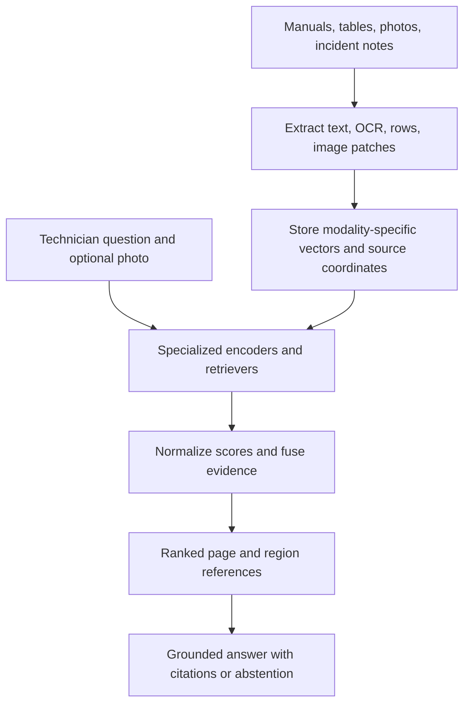

When a machine stops, the useful clue may be a sentence in a manual, a table value, or a mark in a photograph. I want technicians to search all of it in one workflow and get an answer that points to the exact page or image region. I explain the retrieval math, build a vendor-neutral Python design, and follow a maintenance question from query to evidence.

## The business problem

A maintenance team often inherits a library assembled over many years: scanned service manuals, searchable PDFs, wiring diagrams, parts tables, inspection photos, and short incident notes. The documents may use inconsistent names for the same component. A technician may call a part a “return valve” while the manual labels it “RV-14,” and a photograph may show a leak without containing any searchable words at all.

When search covers only extracted text, a relevant diagram or photo is invisible. When it covers only images, a precise fault code or a table value can be missed. And when the answer is generated without traceable evidence, a confident-sounding instruction can be difficult to verify before work begins.

The cost is not limited to search time. A technician may repeat a diagnostic step, choose the wrong part, or escalate a problem the manual already explains. Experienced staff can become the unofficial search engine. A useful system should shorten the path from symptom to evidence without turning retrieved content into unquestioned instructions.

Multimodal Retrieval-Augmented Generation (RAG) addresses the discovery problem. It retrieves material across modalities, preserves where each item came from, and gives a language model only a bounded set of relevant evidence. It does not replace a maintenance procedure, safety review, or qualified technician.

## The idea in plain English

The system starts by treating every source as both content and an address. Text paragraphs, table rows, image regions, and OCR snippets become retrievable units. Each unit keeps provenance such as document ID, page number, bounding box, and extraction method.

At query time, the technician might ask, “What does the dark residue below the return valve indicate?” The application can send that text to several specialized searches: one over manual paragraphs, one over OCR text, one over table rows, and one over visual assets. A photo supplied with the question can trigger a visual-to-visual search as well.

There are two broad ways to connect these searches. A shared embedding space maps different modalities into vectors that are directly comparable, but this works only when the chosen encoders were trained or aligned for that purpose. A text encoder and an image encoder are not automatically compatible because they both return vectors. With late fusion, each modality uses its own encoder and index, produces a ranked list, and the application combines the lists afterwards. Late fusion is a practical default when scores have different meanings or no validated shared space exists.

Image preparation matters. A whole-page image can preserve layout but bury a small label or component. Splitting pages into patches or detecting regions can make local details retrievable, provided each crop retains its page coordinates. OCR can expose printed labels, serial numbers, and table text, but recognition errors and lost spatial relationships must be managed. Tables often need row- or cell-aware extraction rather than a flattened paragraph.

The final answer is generated from selected evidence, not from search scores alone. A citation should identify the source page and region so a person can inspect the original. The retrieval layer should also be able to return “not enough evidence” when the results do not support a safe answer.



## How it works: the math, step by step

Let a source collection contain evidence units such as paragraphs, table rows, and image crops. Each unit has a stable identifier and a provenance record. For modality `m`, let `E_m` be the encoder used to represent that modality and any compatible query representation.

$$
\mathbf{v}_{m,i}=E_m(x_{m,i}), \qquad \mathbf{q}_m=E_m^{(q)}(q)
$$

In plain English: encode source item `i` into a vector for modality `m`, and encode the technician's query into a vector that can be compared with that index. The query encoder may be a text tower aligned with an image tower, or a separate text encoder for a text index. The notation does not claim that different modalities share one space.

### 1. Retrieve within each modality

For a dense-vector index using cosine similarity, the score for query vector `q` and item vector `v` is:

$$
s_{\cos}(\mathbf{q},\mathbf{v})=
\frac{\mathbf{q}\cdot\mathbf{v}}{\|\mathbf{q}\|_2\|\mathbf{v}\|_2}
$$

In plain English: multiply corresponding vector components, add them, and divide by both vector lengths. This measures angular alignment, not certainty that the item is correct. It is appropriate only when the embedding model and index define cosine similarity as a meaningful comparison.

An index can also return a distance, a dot product, a lexical score, or a model-specific relevance value. Some distances are better when smaller, while most similarity scores are better when larger. The application must record that direction instead of silently treating all raw values alike.

### 2. Convert local results into comparable signals

Raw scores from distinct retrievers are generally not calibrated to the same scale. For a simple per-query min-max transformation, let `s_i` be a raw score among the returned candidates:

$$
n_i=
\begin{cases}
\dfrac{s_i-s_{\min}}{s_{\max}-s_{\min}}, & s_{\max}>s_{\min}\\[6pt]
1, & s_{\max}=s_{\min}
\end{cases}
$$

In plain English: map the lowest score in that one result list to zero and the highest to one. If every returned score is equal, assign the same maximum normalized value to them. For a distance where lower is better, reverse the direction before applying this equation.

Min-max normalization is a convenience, not a calibration guarantee. The value 0.8 from image retrieval does not necessarily mean the same relevance as 0.8 from OCR retrieval. It also depends on which candidates happened to be returned. A production system should compare this approach against rank-based fusion or a calibration model fitted on representative relevance judgments.

A rank signal is less sensitive to score units. If item `d` has position `r_m(d)` in modality `m`, one weighted reciprocal-rank score is:

$$
R(d)=\sum_{m\in M}\frac{w_m}{k+r_m(d)}
$$

In plain English: for every modality that found the item, add its weight divided by a smoothing constant plus its position. Higher-ranked results contribute more; an item absent from a modality contributes zero. The weights express deliberate priorities, and `k` controls how quickly rank contributions fall.

Rank fusion is useful when scores are incomparable, but it discards score margins. An item just above another in one list gets the same rank gap as an item far above it. This is why score normalization and rank fusion are alternatives to evaluate, not interchangeable truths.

### 3. Fuse evidence while preserving its identity

With normalized scores, a weighted late-fusion score can be written as:

$$
F(d)=
\frac{\sum_{m\in M}w_m\,n_m(d)}
{\sum_{m\in M}w_m\,\mathbb{1}[d\in C_m]}
$$

In plain English: add the weighted normalized scores for the modalities that returned item `d`, then divide by the weights of those contributing modalities. The indicator is one when that modality's candidate set `C_m` contains the item, and zero otherwise. This averages the available signals rather than penalizing an item merely because a modality did not search it.

The identity `d` needs care. A paragraph and a photograph of the same physical issue are not the same evidence item, so they should not be collapsed into one ID. They may share a parent document or equipment identifier, which can help diversify or group results later. Keep the individual evidence references available even if a presentation layer groups them.

An alternative is to fuse on parent document, then select the best supporting regions inside each document. That can help avoid returning five nearly identical image crops, but it can also hide a distinct piece of evidence. A measured diversity policy is better than discarding source regions during fusion.

### 4. Ground generation in selected evidence

After ranking and filtering, the system selects a context set `S` that fits a model's token budget. One useful objective is to favor relevance while discouraging redundant evidence:

$$
S^\star=\arg\max_{S:\,\operatorname{cost}(S)\leq B}
\left(\sum_{d\in S}F(d)-\lambda\sum_{\substack{d_i,d_j\in S\\i<j}}\operatorname{sim}(d_i,d_j)\right)
$$

In plain English: choose evidence whose total cost stays under budget `B`, rewarding high fused scores and subtracting a penalty when two selected items are too similar. The parameter `lambda` controls the redundancy penalty. This is a conceptual selection objective; a real service can use a greedy approximation and should preserve the citation attached to every selected item.

The language model then receives the question, selected evidence, and instructions to cite supplied sources or say that the evidence is insufficient. Search relevance is not proof of factual support. The answer should link each operational claim to a page or region, and safety-critical steps should remain subject to the organization's approved procedure.

## Implementation in Python

The following is a small orchestration core, not a complete PDF, OCR, vector-database, or LLM integration. The interfaces make those dependencies replaceable. Each modality has its own query encoder and retriever, so the code does not assume a shared embedding space. For text-to-image retrieval, the configured text query encoder must be explicitly compatible with the indexed image vectors.

```python
from dataclasses import dataclass, field
from typing import Literal, Mapping, Protocol, Sequence


Modality = Literal["text", "ocr", "table", "image"]
ScoreMode = Literal["minmax", "rank"]
FusionMode = Literal["weighted_mean", "rrf"]
Vector = Sequence[float]


@dataclass(frozen=True)
class Evidence:
    evidence_id: str
    document_id: str
    modality: Modality
    raw_score: float
    source_name: str
    page: int
    region: str
    excerpt: str


class QueryEncoder(Protocol):
    def encode_query(self, query: str) -> Vector: ...


class ModalityRetriever(Protocol):
    def search(self, vector: Vector, top_k: int) -> Sequence[Evidence]: ...


@dataclass(frozen=True)
class ModalityConfig:
    weight: float
    higher_is_better: bool = True


@dataclass(frozen=True)
class SearchConfig:
    top_k_per_modality: int = 5
    score_mode: ScoreMode = "minmax"
    fusion_mode: FusionMode = "weighted_mean"
    rrf_constant: int = 60
    modalities: Mapping[Modality, ModalityConfig] = field(default_factory=dict)


@dataclass(frozen=True)
class RankedEvidence:
    evidence: Evidence
    fused_score: float


def minmax_scores(
    scores: Sequence[float], higher_is_better: bool
) -> list[float]:
    oriented = [score if higher_is_better else -score for score in scores]
    low, high = min(oriented), max(oriented)
    if high == low:
        return [1.0 for _ in oriented]
    return [(score - low) / (high - low) for score in oriented]


def normalize_results(
    results: Sequence[Evidence],
    higher_is_better: bool,
    mode: ScoreMode,
) -> list[tuple[Evidence, float]]:
    if not results:
        return []
    if mode == "rank":
        ordered = sorted(
            results,
            key=lambda item: item.raw_score,
            reverse=higher_is_better,
        )
        count = len(ordered)
        return [
            (item, (count - position) / count)
            for position, item in enumerate(ordered)
        ]
    scores = minmax_scores(
        [item.raw_score for item in results], higher_is_better
    )
    return list(zip(results, scores))


class MultimodalRetriever:
    def __init__(
        self,
        encoders: Mapping[Modality, QueryEncoder],
        retrievers: Mapping[Modality, ModalityRetriever],
        config: SearchConfig,
    ) -> None:
        if not config.modalities:
            raise ValueError("Configure at least one modality.")
        if any(value.weight <= 0 for value in config.modalities.values()):
            raise ValueError("Modality weights must be positive.")
        self.encoders = encoders
        self.retrievers = retrievers
        self.config = config

    def search(self, query: str) -> list[RankedEvidence]:
        totals: dict[str, float] = {}
        weights: dict[str, float] = {}
        evidence_by_id: dict[str, Evidence] = {}

        for modality, settings in self.config.modalities.items():
            if modality not in self.encoders or modality not in self.retrievers:
                raise ValueError(f"Missing encoder or retriever for {modality}.")
            vector = self.encoders[modality].encode_query(query)
            results = self.retrievers[modality].search(
                vector, self.config.top_k_per_modality
            )
            if self.config.fusion_mode == "rrf":
                ordered = sorted(
                    results,
                    key=lambda item: item.raw_score,
                    reverse=settings.higher_is_better,
                )
                contributions = [
                    (item, 1.0 / (self.config.rrf_constant + rank))
                    for rank, item in enumerate(ordered, start=1)
                ]
            else:
                contributions = normalize_results(
                    results, settings.higher_is_better, self.config.score_mode
                )
            for item, score in contributions:
                if item.modality != modality:
                    raise ValueError("Retriever returned mismatched modality.")
                evidence_by_id[item.evidence_id] = item
                totals[item.evidence_id] = (
                    totals.get(item.evidence_id, 0.0) + settings.weight * score
                )
                if self.config.fusion_mode == "weighted_mean":
                    weights[item.evidence_id] = (
                        weights.get(item.evidence_id, 0.0) + settings.weight
                    )

        ranked = []
        for key, total in totals.items():
            score = (
                total / weights[key]
                if self.config.fusion_mode == "weighted_mean"
                else total
            )
            ranked.append(RankedEvidence(evidence_by_id[key], score))
        return sorted(ranked, key=lambda item: item.fused_score, reverse=True)
```

Configure `score_mode` as `minmax` or `rank` for weighted-mean fusion, or choose `fusion_mode="rrf"` to combine positions with reciprocal-rank fusion. In RRF mode, `rrf_constant` smooths rank contributions and `score_mode` is not used. For example, assume adapters have already been constructed for each index:

```python
config = SearchConfig(
    score_mode="minmax",
    fusion_mode="weighted_mean",
    modalities={
        "text": ModalityConfig(weight=0.35),
        "ocr": ModalityConfig(weight=0.20),
        "table": ModalityConfig(weight=0.20, higher_is_better=False),
        "image": ModalityConfig(weight=0.25),
    },
)
search = MultimodalRetriever(encoders, retrievers, config)
evidence = search.search("What should I inspect below the return valve?")
```

A deployment can substitute a learned calibration layer or backend-specific score adapter without changing the encoders' responsibilities. The language model should receive the selected evidence, including `source_name`, `page`, `region`, and `excerpt`, through a generation interface whose response contract requires citations and supports abstention. Do not send bare vectors or scores to the language model and expect it to reconstruct provenance.

Until a labeled evaluation set supports different priorities, equal initial modality weights and rank normalization provide a simple baseline. Validate that baseline before using it for operational decisions.

In a fuller implementation, index construction has a separate `DocumentEncoder` interface for paragraphs, table rows, OCR regions, and image patches. Keep model version, preprocessing settings, page dimensions, and crop coordinates in metadata. Query encoders must be paired with the right index version; if a model changes, re-embedding and index migration should be explicit.

## A worked example

Suppose the technician asks, “What should I inspect when residue appears below the return valve?” Each modality retriever returns one matching item and one other candidate:

| Evidence | Modality | Raw score | Provenance |
| --- | --- | ---: | --- |
| E1 | Text | 0.82 | Service manual, page 18, paragraph 3 |
| E2 | OCR | 8.0 | Service manual, page 19, label region |
| E3 | Image | 0.40 | Inspection photo, page 1, lower valve crop |
| E4 | Table | 0.30 | Parts schedule, page 22, row RV-14 |

Assume text, OCR, and image scores are similarities where higher is better. The table retriever returns distances where lower is better. Each modality returns just two results. For an auditable example, suppose the other scores are 0.20 for text, 2.0 for OCR, 0.10 for image, and 0.70 for table distance. Min-max normalization yields:

$$
n(E1)=\frac{0.82-0.20}{0.82-0.20}=1,\quad
n(E2)=\frac{8-2}{8-2}=1,\quad
n(E3)=\frac{0.40-0.10}{0.40-0.10}=1
$$

In plain English: each item is the best of its own two-result list, so its local normalized score is one. Those three ones are not direct evidence that the underlying modalities are equally confident.

For the table distance, reverse direction by negating scores. The matching row has distance 0.30, which is better than 0.70:

$$
n(E4)=\frac{-0.30-(-0.70)}{-0.30-(-0.70)}=1
$$

In plain English: after reversing the distance direction, the nearer row is the best result and normalizes to one. This confirms why score direction belongs in configuration.

Now assign weights of 0.35 to text, 0.20 to OCR, 0.25 to image, and 0.20 to table. As each of E1 through E4 appears in only one modality list, their fused scores equal their single normalized signal: all are 1.0. That tie is a limitation of per-list min-max normalization, not a bug in the arithmetic. In practice the retrievers would return more candidates, calibrated scores might preserve useful separation, or rank fusion could determine a stable ordering. Here, use a small tie-break based on a second measure only if it has been validated; otherwise show a transparent set of evidence rather than inventing a distinction.

The technician then sees the manual paragraph, the OCR label, the valve crop, and the parts row with their source references. The language model can summarize what those sources say, but must cite page 18, page 19, the photo crop, and row RV-14 separately. It should not claim a diagnosis merely because the crop and paragraph ranked highly. If the documents do not explain the residue or the evidence conflicts, the right response is to request inspection or escalation under the approved procedure.

## Pitfalls and when not to use it

- **Assuming embeddings align.** Equal vector dimensions do not make text and image vectors comparable. Validate a joint space on domain examples or keep modality-specific retrieval and fuse rankings later.
- **Treating normalized scores as probabilities.** Per-query min-max scores depend on the result set and can create artificial ties. Evaluate calibration and rank-based alternatives with human judgments.
- **Losing the original layout.** OCR can detach a value from a table heading, and an image crop can lose its page context. Preserve page coordinates, table structure, and a link to the original.
- **Indexing whole pages indiscriminately.** A full-page image embedding can miss a small but important indicator. Compare page-level retrieval with overlapping patches or detected regions, and maintain region-to-page mapping.
- **Over-relying on OCR.** Skew, glare, handwriting, faint print, and unusual fonts can produce false text. Keep confidence and extraction provenance, and allow the technician to inspect the source image.
- **Returning duplicate evidence.** Adjacent patches may show the same component. Apply measured diversity or group by parent document while retaining individual citations.
- **Ignoring updates and access control.** Re-index changed manuals and enforce permissions before retrieval, not after context is sent to a model.
- **Using generated answers as procedures.** Do not use multimodal RAG as the sole control for hazardous work, emergency response, or regulated decisions. Search may support a qualified person, but it cannot approve the action.

If the library is small, well-structured, and text-only, conventional keyword and semantic search may be simpler and easier to validate. Add modalities only when they address a demonstrated retrieval gap.

## Measuring success in production

Measure retrieval and operational value separately. Build a reviewed test set with relevant passages, table rows, OCR labels, and image regions. Include alternate terminology, fault codes, poor scans, photo queries, and questions the collection cannot answer.

Track recall at `K` for each modality and overall, plus reciprocal rank or nDCG to understand whether strong evidence appears near the top. Measure citation coverage and citation correctness: a citation that exists but does not support the sentence is not a successful citation. For generated responses, sample whether claims are grounded, whether unsupported questions produce abstention, and whether technicians can reach the cited page or region.

Business measures can include time to find a procedure, repeat searches, avoidable escalations, and technician-rated usefulness. Compare with a baseline, segment by asset class and scan quality, and account for changes in case mix, staffing, and process.

Also track indexing lag, OCR failure, latency by modality, model and storage cost, access-control denials, and stale sources. Review false negatives and unsafe answers with domain experts. A launch decision should combine retrieval quality, provenance integrity, and an agreed human-review process.

## Checklist

- Define which maintenance questions genuinely require text, images, tables, or OCR.
- Preserve source IDs, revision, page, region coordinates, and extraction method.
- Select modality encoders based on validated alignment, not vector shape.
- Keep separate indexes when cross-modal compatibility is not established.
- Declare score direction and normalization or fusion strategy per retriever.
- Test with representative relevance labels, including unanswerable questions.
- Show evidence references and allow inspection of the original source.
- Require grounded citations and abstention for insufficient evidence.
- Enforce permissions and manual-version controls throughout indexing and retrieval.
- Monitor retrieval quality, answer safety, latency, cost, and technician outcomes.

## Final thought

Multimodal RAG is most useful when important evidence is genuinely split across different forms. Its core discipline is not mixing every vector into one search, but connecting appropriate encoders to trustworthy retrieval, comparing results carefully, and keeping every claim attached to its source. For more on applying this pattern in an organization, see [Enterprise Generative AI](/services/#enterprise-generative-ai) or [get in touch](/contact/). For a related retrieval pattern focused on lexical and semantic search, read [Hybrid Search RAG: From Concept to Implementation](/posts/2026-10-22-hybrid-rag-from-concept-to-implementation/).

For other RAG architectures, read [GraphRAG](/posts/2026-11-01-graphrag-concept-to-implementation/), [Agentic RAG](/posts/2026-10-25-agentic-rag-concept-to-implementation/), and [Corrective RAG](/posts/2026-11-01-corrective-rag-crag-concept-to-implementation/).
